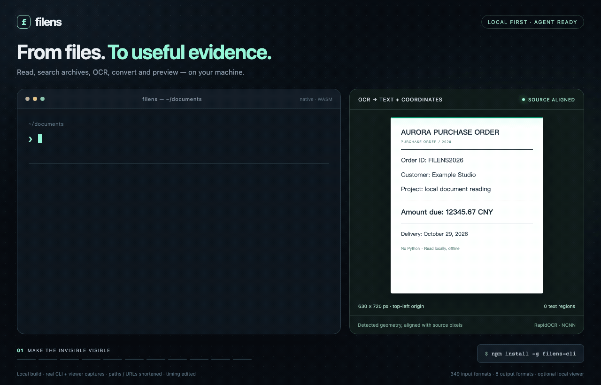
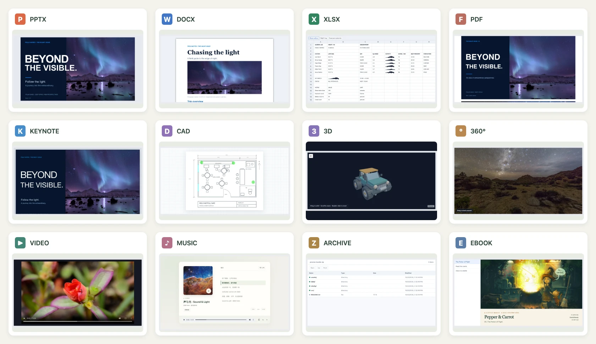
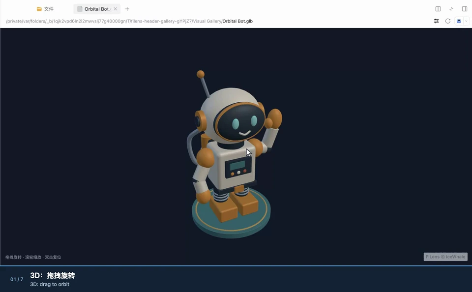

<div align="center">
  
  <h1>filens</h1>
  <p><strong>An Agent CLI. A pure frontend viewer for complex file formats.</strong></p>
  <p>Read, search, OCR, convert and preview local files. Files stay on your device.</p>
  <p>English · <a href="README.zh-CN.md">简体中文</a> · <a href="LICENSE">MIT</a></p>
</div>



[](apps/demo/public/home/filens-demo.mp4)

[▶ Watch the 30-second walkthrough](apps/demo/public/home/filens-demo.mp4) · [Animated preview](docs/assets/readme/demo.gif) · [Format coverage and limits](docs/support-matrix.md)

| | Agent CLI | Pure frontend previews |
| --- | --- | --- |
| Use it for | Give Agents source text, search results, OCR and cited evidence; open a browser preview. | Preview Office, iWork, PDF, CAD / 3D, RAW, panoramas, archives and more in your app. |
| Supported formats (by extension) | **349**. | **450**, including direct previews and previews after local WASM conversion. |
| Approximate size | **Lite components: 8.00–9.27 MiB · Full components: 31.43–37.06 MiB**, including OCR runtime and models. | **A few KB to hundreds of KB per compressed chunk**; shared dependencies, workers and WASM add to the total. An **all-in-one JS file** is also available. |
| Start here | [Install and use the CLI](#agent-cli) | [Preview and integrate](#pure-frontend-previews) |

The native executable is **0.92–2.20 MiB**. Lite and Full sizes include the launcher, native executable and document WASM; Full also includes OCR runtime and models. Sizes vary by platform and exclude Node.js, caches and preview assets. Release offline bundles also include the preview runtime; see [complete archive and extracted sizes](docs/preview-release-sizes.json) (1 MiB = 1,048,576 bytes). Frontend chunk figures describe compressed build artifacts. Preview 0.3.4 source-build main runtimes: **4.73 MB Brotli** summed across split files, or **3.85 MB Brotli / 3.99 MB gzip / 7.26 MB raw** for the supplied precompressed all-in-one JS. Optional archive WASM and worker add **0.36 MB Brotli / 0.46 MB gzip / 1.17 MB raw** to either build. Main runtimes include Vue, styles, document/image/STEP WASM and their workers. Media uses browser codecs with a small HEIC/HEIF decoder fallback. [CLI measurements](docs/agent-cli-npm-release.json) · [Standalone measurements](docs/preview-build-sizes.json).

## Agent CLI

**Supports 349 file formats (counted by extension).** Read PDFs, Office documents, spreadsheets, scans and images locally. Search directories and nested archives; extract key original passages; find duplicate files and similar images. Outputs include text, JSON, Markdown, HTML, YAML, XML, CSV and TSV, with available page coordinates and document structure. Check `filens capacity --json` for your installation's capabilities; extraction fidelity varies by format. Paraphrasing, translation and question answering belong to the calling Agent.

### Installation and use

**Ask your Agent to install it:**

> Install filens for me. Find skills/filens/SKILL.md at https://github.com/IceWhaleTech/filens and follow it to set up the CLI and skill.

[Skill guide](skills/filens/SKILL.md) · For manual installation, download your platform’s offline bundle from the [latest Release](https://github.com/IceWhaleTech/filens/releases/latest) and extract the entire archive. Full includes OCR and models; Lite leaves OCR optional. Both include offline preview assets and need no Node.js or npm.

```sh
filens 'read "report.pdf" as json'
filens 'search "./documents" for "budget risk" as json'
filens summarize report.pdf --query 'budget risk' --json
filens convert report.doc report.docx

filens inspect unknown-file --json
filens capacity --json
```

`filens inspect FILE --json` identifies the actual format from bounded content reads, reports MIME/evidence and extension mismatches, and keeps ambiguous inputs explicit. It uses no OCR and does not validate the entire file.

### Offline browser previews

**CLI 0.5.6:** `filens preview report.pdf` creates a self-contained HTML with the source file, preview engine and licenses, opens it locally and exits. No server or file upload is needed. Release bundles include preview 0.3.4. Other installation methods can prepare preview assets in advance with `filens setup-preview`. The frontend package includes both builds and is measured separately: [package sizes](docs/preview-package-sizes.json).

```sh
# Export a portable offline preview; existing files are never overwritten
filens preview report.pdf --output report-preview.html --no-open
# Return the generated file URL and path as JSON
filens preview report.pdf --no-open --json
# Browser compatibility mode: loopback HTTP server, Ctrl-C to stop
filens preview report.pdf --mode serve
```

The HTML checks browser capabilities and blocks external resource requests. It contains a copy of the original file; temporary HTML files remain after exit. Safari/WebKit iWork previews require HTTP compatibility mode. [Preview setup and limits](packages/preview/README.md#cli-preview) · [Browser validation](docs/preview-html-validation.json).

### ZimaOS

**[ZimaOS ModStore](https://github.com/IceWhaleTech/Mod-Store/tree/main/builtin/filens):** install with `sudo zpkg install filens`. To upgrade, run `sudo zpkg update` and `sudo zpkg upgrade filens`. ModStore 0.5.1 includes the offline HTML preview engine for Linux x64/arm64 and always skips browser launching. Download or copy the generated HTML to your computer; `--json` returns its path on ZimaOS. Node.js and npm are not required. [Install, export previews and configure OCR](packaging/zimaos/README.md).

<details>
<summary>CLI sizes, capabilities and further examples</summary>

<!-- agent-cli-size:en:start -->
  <p><strong>CLI executable 2.20 MiB · Lite 9.27 MiB · Full 32.49 MiB · <a href="LICENSE">MIT</a></strong><br /><sub>v0.5.6 · macOS arm64 · Lite/Full component sizes exclude offline preview assets; Full includes OCR models; <a href="docs/agent-cli-npm-release.json">all platform sizes</a></sub></p>
<!-- agent-cli-size:en:end -->

- [Installation, protocol and packaging](docs/agent-cli.md) · [Agent skill](skills/filens/SKILL.md)
- [Output formats and layouts](docs/agent-cli-formats-and-layout.zh-CN.md) · [68 observed examples and limits](docs/agent-cli-examples.zh-CN.md)
- [Search](docs/agent-cli-search.zh-CN.md), [nested archives](docs/agent-cli-search-archives.zh-CN.md) and [model-free key excerpts](docs/agent-cli-pruning.zh-CN.md)
- [Duplicates and similar images](docs/agent-cli-similarity.md) · [Windows setup and validation status](docs/agent-cli-windows.zh-CN.md)
- [Search coverage](docs/agent-cli-search-formats.zh-CN.md), [retrieval benchmarks](docs/agent-cli-search-benchmark.zh-CN.md) and [startup costs](docs/agent-cli-search-native.zh-CN.md)

The CLI uses Rust and the same frontend conversion core. Full bundles RapidOCR NCNN (max side 960, two OpenMP threads); Lite adds it with `filens setup-ocr`. Inspect `capacity` for the installed build's operations and conversion pairs. Natural-language requests recognize a bounded set of intents; use explicit `--pages` / `--slides` for selection. Field-specific questions are not implemented. Windows/Linux native execution remains pending validation.

**macOS OCR comparison:** Apple Vision is faster on the tested warm image calls, but loses tiny text and can be less accurate on blurred input; fresh-process latency is also higher. It cannot yet replace RapidOCR across this project's requirements. [Measurements, capability gaps and reproduction](docs/macos-ocr-benchmark.zh-CN.md).

</details>

## Pure frontend previews

**Preview 450 file formats in the browser with no upload or conversion server.** Counted by extension, including direct previews and previews after local WASM conversion. Browse Keynote slides, Pages pages and Numbers sheets; read Office and PDF documents; inspect CAD and 3D models; view RAW photos and 360° photos or video. See the [support matrix](docs/support-matrix.md) for coverage and limits by format.

### DeepSeek Harness

[CLI tools and native sidebar previews](integrations/deepseek-harness/README.md) for **450 file formats** (counted by extension, including local WASM conversion), installed together and enabled independently. Tested with DSH Desktop 0.2.1-rc.5 and Web 0.2.2-alpha.3. In Desktop, open **Plugins → Add plugin**, enter `dsh-filens` (or `dsh-filens@0.1.5` to pin the version), click **Install**, then **Enable now**. [Installation and configuration](integrations/deepseek-harness/README.md#install-and-build).

<!-- dsh-package-metrics:start -->
**Published dsh-filens 0.1.5: 6.53 MiB download / 19.58 MiB unpacked**, including preview 0.3.4. CLI 0.5.6 / OCR, DSH shared dependencies and package-manager caches are separate. [Package measurements](docs/dsh-plugin-publication.json).
<!-- dsh-package-metrics:end -->

[0.1.5 controls and package validation](docs/dsh-header-controls-validation.json). Performance tables retain the measured 0.1.3 snapshot.


Preview Office files directly in the sidebar, switch worksheets, and present PPT slides fullscreen: click the fullscreen slide to focus, use **Page Down / Page Up**, then **Esc** to return to DSH. DOCX/PPTX render locally without an Office-to-PDF step.

| Sample · first / cached median (ms) | FiLens 0.1.3 | DSH built in | First-open speedup |
| --- | ---: | ---: | ---: |
| PPTX | **135 / 81** | 1830 / 124 | **13.56×** |
| DOCX | **111 / 94** | 1827 / 112 | **16.46×** |
| PDF | **190 / 77** | 329 / 110 | **1.73×** |

Nine paired rounds on one macOS machine. Speedup = matched built-in median ÷ FiLens median; ratios describe **first opens**. First means the first opening of that file per process; system/persistent caches remain. Built-in Office converts to PDF; FiLens renders directly. [Ranges and method](docs/assets/dsh-plugin/performance-retest.zh-CN.md) · [MP4](docs/assets/dsh-plugin/install-and-preview.mp4) · [GIF](docs/assets/dsh-plugin/install-and-preview.gif).

PDF uses a separate nine-round paired run after first-page pixel reuse: cached opens are **1.43×** faster than built in (**110 → 77 ms**, **30.0%** less time). The 689,455-byte sample still loads and validates on every open; closing releases the worker. [PDF samples, ranges and method](docs/assets/dsh-plugin/pdf-reopen-optimization.zh-CN.md).

The workloads below time complete parser calls on identical inputs, **excluding UI rendering**; these are separate from sidebar latency. Engines alternate over two warmups and nine measured rounds. Every cell value or complete entry text is verified. Small examples and low-gain cases are omitted from the featured tables.

| Larger parsing workload | Baseline | Baseline / FiLens median (ms) | Speedup |
| --- | --- | ---: | ---: |
| XLSX · 2,000 × 64, 128,000 cells | SheetJS CE 0.20.3 | 150.94 / **61.72** | **2.45×** |
| XLSX · 8,000 × 64, 512,000 cells | SheetJS CE 0.20.3 | 615.71 / **213.50** | **2.88×** |
| ZIP · 10,000 entries, 18.34 MiB expanded | JSZip 3.10.1 | 700.55 / **55.52** | **12.62×** |
| ZIP · 2,500 entries, 36.23 MiB expanded | JSZip 3.10.1 | 247.99 / **95.37** | **2.60×** |

Library feature/fidelity scopes differ; these ratios are not an overall ranking across files. [Raw samples and reproduction](docs/featured-performance.md).

**DSH 0.1.5:** all format controls sit beside the address bar: page navigation, rotation, worksheet tabs, archive search, audio/video playback, attachments and the 3D inspector. Manual Fit / Width / Height buttons are omitted. The matching driver loads on first use; modules and WASM are reused. Initial JS requests total **350.3 KiB**; TXT first-open runtime requests total **454.8 KiB**, excluding document bytes and DSH. [0.1.5 runtime measurements](docs/assets/dsh-plugin/format-loading-current.json). The installation recording uses public 0.1.3; the 3D/360° gallery records the same preview runtime shipped in 0.1.5. PDF reopens reuse validated first-page pixels, bounded to four pages / 16 MiB / 30 idle seconds; each open still loads and validates its document, and closing releases the worker. Password opens and printing bypass reuse. [PDF timings and limits](docs/assets/dsh-plugin/pdf-reopen-optimization.zh-CN.md).

Version 0.1.3 also reuses parsed XLSX/iWork models and STEP CPU meshes within a shared four-entry / 64 MiB estimated model budget / 30-second idle lifetime. [Complete measurements, costs and limits](docs/assets/dsh-plugin/model-reopen-optimization.zh-CN.md).



Drag to orbit **GLB / 3MF models**, zoom into details, look around **360° photos**, and change your view while **360° video plays**. The panorama samples use `.pano` / `.360v` filenames to select spherical viewing. [Full gallery MP4 and sample credits](docs/assets/dsh-plugin/README.md#3d-and-360-gallery) · [GIF](docs/assets/dsh-plugin/3d-and-panorama.gif).

### Browser integration: single file or split modules

Download a browser preview ZIP from the [latest Release](https://github.com/IceWhaleTech/filens/releases/latest). Deploy the complete split directory, or choose the all-in-one JS build. Keep the archive sidecars to enable RAR / 7z.

The same API is available in both builds. Vue, styles and the conversion engines are included; your app needs no Vue installation.

```html
<div id="preview" style="height: 80vh"></div>
<script type="module">
  // Deploy the entire extracted directory; the split build loads engines as needed.
  import { createPreview } from './filens.js';
  // The all-in-one build uses the same entry point with styles, WASM and workers included.
  // Keep the archive sidecars for RAR / 7z.

  const viewer = createPreview('#preview', { src: './report.pdf', name: 'report.pdf' });
  // viewer.update({ src: anotherFile, name: anotherFile.name });
  // viewer.destroy();
</script>
```

Deploy the extracted runtime directory and import its `filens.js` over HTTP(S). For a Vue app, use the shared [`Preview` component](packages/vue/README.md); for direct JavaScript integration and CLI previews, see the [standalone guide](packages/preview/README.md). Single-file packaging trades a larger initial download for simpler deployment; it has the same format limits as the split build.

### iOS / Android SDKs

Source SDKs are available as a local Swift Package and an Android
Library, sharing the offline frontend and WASM runtime. See the
[mobile SDK integration guide](sdk/README.md) and
[runtime, npm and SDK sizes](docs/preview-sizes.md).

### Format coverage

| Files | Preview | Main limits |
| --- | --- | --- |
| PPTX, Keynote / Pages / Numbers | Slide, page and worksheet canvases. | Fidelity varies by layout, fonts and objects. |
| DOCX, XLSX / CSV, PDF | Documents, sheets and paged PDFs. | Read-only; advanced styling may differ. |
| DOC / XLS / PPT, WPS / ET / DPS | Local WASM conversion for preview. | Preview-focused; macros are stripped. |
| PSD / PSB, AI / EPS / PS | Saved composite images or vector PDF. | 8-bit RGB/grayscale for Photoshop; bounded PostScript preview subset. [Design limits](docs/design-preview.md). |
| DXF, STEP / STP, mesh models | Pan drawings and orbit 3D geometry. | STEP omits source colors, names and assembly trees. |
| RAW, common images and icons | Embedded JPEG first, lightweight RAW development as fallback. | Camera coverage and image quality vary. |
| 360° photos and video | Interactive viewing and supported camera-original stitching. | Stitching is experimental; metadata, sidecars and browser codecs matter. |
| Archives, ebooks, code, mind maps and diagrams | Browse entries, chapters, source and node relationships. | Each format supports a documented subset. |

### Bundle sizes and loading costs

<details>
<summary>Detailed bundle sizes and loading costs</summary>

<!-- bundle-sizes:en:start -->
| Module / core | Raw | gzip | Brotli |
| --- | ---: | ---: | ---: |
| Conversion core WASM (Office detection) | 910.9 KiB | 408.9 KiB | **329.8 KiB** |
| Image / RAW core WASM | 2915.6 KiB | 940.3 KiB | **713.2 KiB** |
| Media / panorama preview | 464.6 KiB | 128.7 KiB | **108.3 KiB** |
| truck STEP WASM | 925.5 KiB | 326.4 KiB | **255.0 KiB** |

Document, image / RAW, and STEP WASM modules load independently on demand. Media preview and image conversion are measured separately. JS rows include their CSS; shared dependencies and workers are listed separately.

<details>
<summary>All modules and initial loading cost</summary>

| Module / core | Raw | gzip | Brotli |
| --- | ---: | ---: | ---: |
| Office decryption WASM (optional) | 370.4 KiB | 160.3 KiB | **127.6 KiB** |
| HEIC / HEIF decoder WASM | 1423.8 KiB | 470.2 KiB | **344.5 KiB** |
| Demo entry | 239.9 KiB | 68.6 KiB | **57.4 KiB** |
| Agent CLI demo UI | 34.9 KiB | 13.5 KiB | **11.1 KiB** |
| Shared vendor dependencies | 813.1 KiB | 229.7 KiB | **192.0 KiB** |
| PPTX / core runtime | 380.9 KiB | 106.6 KiB | **90.1 KiB** |
| Vue preview host | 198.3 KiB | 54.5 KiB | **43.5 KiB** |
| DOCX / XLSX / PDF | 51.7 KiB | 16.0 KiB | **14.4 KiB** |
| On-demand DOCX engine | 74.6 KiB | 20.1 KiB | **18.1 KiB** |
| Office attachments | 31.4 KiB | 12.1 KiB | **11.0 KiB** |
| Shared XML compatibility | 27.2 KiB | 8.9 KiB | **8.0 KiB** |
| Shared ZIP compatibility | 41.5 KiB | 12.7 KiB | **11.6 KiB** |
| Encrypted ZIP support | 99.1 KiB | 37.0 KiB | **32.3 KiB** |
| On-demand PDF engine | 435.2 KiB | 128.1 KiB | **106.9 KiB** |
| iWork preview | 40.6 KiB | 12.2 KiB | **10.8 KiB** |
| CAD / mind maps / diagrams | 93.0 KiB | 26.0 KiB | **22.2 KiB** |
| 3D preview | 109.0 KiB | 31.7 KiB | **27.7 KiB** |
| glTF / GLB model loader | 42.7 KiB | 12.6 KiB | **11.3 KiB** |
| FBX model loader | 43.9 KiB | 14.1 KiB | **12.6 KiB** |
| OBJ model loader | 8.5 KiB | 2.9 KiB | **2.6 KiB** |
| MTL model loader | 4.2 KiB | 1.7 KiB | **1.5 KiB** |
| 3DS model loader | 8.4 KiB | 2.8 KiB | **2.5 KiB** |
| LDraw model loader | 24.0 KiB | 8.3 KiB | **7.3 KiB** |
| USDZ model loader | 8.5 KiB | 2.7 KiB | **2.4 KiB** |
| VRML model loader | 178.0 KiB | 46.4 KiB | **39.7 KiB** |
| Media decoder loader | 143.1 KiB | 52.5 KiB | **45.5 KiB** |
| Archive preview | 48.1 KiB | 14.6 KiB | **13.1 KiB** |
| RAR / 7z extraction WASM (optional) | 1089.9 KiB | 429.8 KiB | **332.3 KiB** |
| Archive worker (optional) | 51.5 KiB | 18.2 KiB | **16.3 KiB** |
| Text / ebooks | 18.1 KiB | 6.9 KiB | **6.1 KiB** |
| iWork worker | 884.9 KiB | 183.4 KiB | **153.3 KiB** |
| PDF worker | 1053.3 KiB | 291.1 KiB | **233.1 KiB** |
| truck STEP loader | 2.8 KiB | 1.4 KiB | **1.2 KiB** |

Entry, preloaded JS, and CSS total **459.5 KiB Brotli** (1940.1 KiB raw / 546.4 KiB gzip), plus images, video, and samples. Modules share dependencies; these rows are not standalone per-format download totals.

</details>

Measured from the demo build. Compression columns describe artifacts; actual transfer depends on hosting. [Full report and reproduction](docs/bundle-sizes.md).
<!-- bundle-sizes:en:end -->

The [format package audit](docs/format-package-sizes.md) records dependency sharing,
worker packaging and measured savings for applications combining the npm libraries.

The table above is the recorded demo-build snapshot. The new standalone builds have their own [complete measurements](docs/preview-build-sizes.json), including embedded dependencies. Individual chunks are not independent per-format download totals.

</details>

### Frontend project comparisons

<details>
<summary>Frontend project comparisons</summary>

| Frontend project | iWork | 360° photos / video | RAW preview | Native PPTX | CAD / 3D |
| --- | --- | --- | --- | --- | --- |
| **filens** | **✅ All three** | **✅** | **◐** | **✅** | **✅** |
| [SheetJS CE](https://docs.sheetjs.com/docs/miscellany/formats/) | ◐ Numbers | — | — | — | — |
| [Photo Sphere Viewer](https://github.com/mistic100/Photo-Sphere-Viewer) | — | ✅ | — | — | — |
| [LibRaw-Wasm](https://github.com/ybouane/LibRaw-Wasm) | — | — | ✅ | — | — |
| [vue-office](https://github.com/501351981/vue-office) | — | — | — | ✅ | — |
| [PPTist](https://github.com/pipipi-pikachu/PPTist) | — | — | — | ✅ | — |
| [Online 3D Viewer](https://github.com/kovacsv/Online3DViewer) | — | — | — | — | ✅ |

<sub>✅ Available path · ◐ Partial or conditional support · — No built-in path documented. [Format coverage and limits](docs/support-matrix.md).</sub>

**iWork, panoramas, RAW, Office, and CAD / 3D in one browser-local workspace.** The projects above specialize in different areas; filens brings these previews together.

<details>
<summary>Comparison notes and support boundaries</summary>

- Entries follow public documentation and browser-local processing paths, rather than overall project rankings. Support and fidelity vary by file.
- **iWork / PPTX:** filens previews Keynote, Pages, and Numbers natively. SheetJS extracts Numbers table data and needs an application UI. PPTist imports PPTX into its presentation model; vue-office's [PPTX core is not open source](https://github.com/501351981/pptx-preview#关于授权).
- **Panoramas:** both filens and Photo Sphere Viewer display photos and video. filens also handles supported X5 INSP originals, Insta360 / DJI calibration and distortion, original-track synchronization, and calibrated DNG stitching. Camera-original stitching is experimental and depends on metadata, companion files, and browser codecs. PSV's [generic dual-fisheye adapter](https://photo-sphere-viewer.js.org/guide/adapters/dual-fisheye.html) does not parse X5 calibration.
- **RAW:** filens prioritizes embedded JPEGs, then lightweight sensor development. LibRaw-Wasm offers full / half-size decoding and development through an API that needs an application UI. These paths have different image-quality goals.
- **CAD / 3D:** filens covers DXF, STEP, and mesh previews. Online 3D Viewer specializes in model viewing, inspection, and export, including STEP / IGES / IFC. filens STEP previews retain geometry and instance placement, but omit source colors, names, and the assembly tree.

</details>

</details>

## Run the demo locally

Requires Node.js 20+ and [Rust via rustup](https://rustup.rs/). The repository pins the Rust compiler and WASI target.

```sh
npm ci
npm run build:wasm
npm run dev --workspace @filens/demo
```

Open [the local demo](http://localhost:5173/modules/filens/?lang=en), choose a sample or drop in a file. For hosting, see the [Vercel guide](docs/deploy-vercel.md).

## Install on ZimaOS

<p align="center"><a href="https://www.zimaspace.com/en/zimaos?utm_source=github&amp;utm_medium=referral&amp;utm_campaign=filens_zimaos&amp;utm_content=readme_banner_en"></a></p>

Install FiLens from the official Mod Store. In the ZimaOS terminal or over SSH, run:

```sh
sudo zpkg install filens
```

This installs the native CLI and shared WASM engines for Linux x64/arm64, with no Node.js dependency. Run `filens capacity --json`, then `filens read report.pdf --json`. OCR reuses Photos' installed NCNN v7 runtime and RapidOCR models. If they are absent or incompatible, `filens setup-ocr` installs a compatible private copy; document reading and conversion work without OCR.

On ZimaOS, `filens preview report.pdf --output report-preview.html --json` exports an HTML without launching a browser. Download or copy it to your computer to open it. HTTP compatibility mode requires an SSH tunnel to the loopback port.

If the module is not found, run `sudo zpkg update` to refresh the store index, then retry. See the [ZimaOS packaging guide](packaging/zimaos/README.md) for building, publishing and updating the package.

## Performance and documentation

HEIF decoder source versions, rebuild steps, and Apple-edited 10-bit color regression:
[HEIF decoder build](packages/converter-client/vendor/libheif/README.md).

<details>
<summary>Show SOTA benchmark results</summary>

Updated November 5, 2026. The parser shortlist retains larger inputs with at least **2×** measured speedups; smaller and lower-gain cases remain in the full reports. The DSH comparison also includes PDF.

**Complete DSH sidebar previews**

| Sample · first / cached median (ms) | FiLens 0.1.3 | DSH built in | First-open speedup |
| --- | ---: | ---: | ---: |
| PPTX | **135 / 81** | 1830 / 124 | **13.56×** |
| DOCX | **111 / 94** | 1827 / 112 | **16.46×** |
| PDF | **190 / 77** | 329 / 110 | **1.73×** |

Ratios in this table describe first opens. PDF cached opens improve **1.43×** (110 → 77 ms). Office and PDF use separate nine-round paired measurements.

**Large-input parsing against specialized libraries**

| Larger parsing workload | Baseline | Baseline / FiLens median (ms) | Speedup |
| --- | --- | ---: | ---: |
| XLSX · 2,000 × 64, 128,000 cells | SheetJS CE 0.20.3 | 150.94 / **61.72** | **2.45×** |
| XLSX · 8,000 × 64, 512,000 cells | SheetJS CE 0.20.3 | 615.71 / **213.50** | **2.88×** |
| ZIP · 10,000 entries, 18.34 MiB expanded | JSZip 3.10.1 | 700.55 / **55.52** | **12.62×** |
| ZIP · 2,500 entries, 36.23 MiB expanded | JSZip 3.10.1 | 247.99 / **95.37** | **2.60×** |

Nine measured rounds after two warmups, alternating library order; all cell values or complete entry texts verified. These parser timings exclude rendering, imports, network and verification. The DSH rows include preview rendering. Results are limited to the named workloads and baselines; they do not establish a universal ranking or identical feature coverage. [Methods, versions, raw samples and reproduction](docs/featured-performance.md) · [Historical comparisons](docs/performance-comparison.md).

</details>

| Looking for… | Start here |
| --- | --- |
| Standalone single-file / split builds and CLI preview | [Preview guide](packages/preview/README.md) |
| Vue integration | [Vue components](packages/vue/README.md) |
| Supported formats | [Support matrix](docs/support-matrix.md) |
| Browser media without a conversion server | [Integration, limits and validation](docs/browser-media-engine.md) |
| Architecture and WASM boundaries | [Project overview](docs/project-overview.md) |
| Frontend benchmarks and raw data | [Performance comparison](docs/performance-comparison.md) |
| macOS native OCR vs RapidOCR | [Measured comparison](docs/macos-ocr-benchmark.zh-CN.md) |
| CLI and backend integration | [Agent CLI](docs/agent-cli.md) · [Go + wazero host](examples/go-wazero-converter/README.md) |

Try your files and [report a reproducible issue](https://github.com/IceWhaleTech/filens/issues/new/choose). [Roadmap](docs/roadmap.md) · [MIT license](LICENSE) · [Third-party notices](packaging/agent-third-party.md).

<sub>Preview captures come from filens. Photos and demo recordings retain their original licenses; see <a href="docs/assets/readme/SOURCES.md">visual sources and credits</a>. iWork research: <a href="https://github.com/dunhamsteve/iwork">dunhamsteve/iwork</a>; CAD lineage: <a href="https://github.com/orcastor/cad2x-converter">orcastor/cad2x-converter</a>.</sub>

## Star History

[](https://star-history.com/#IceWhaleTech/filens&Date)
