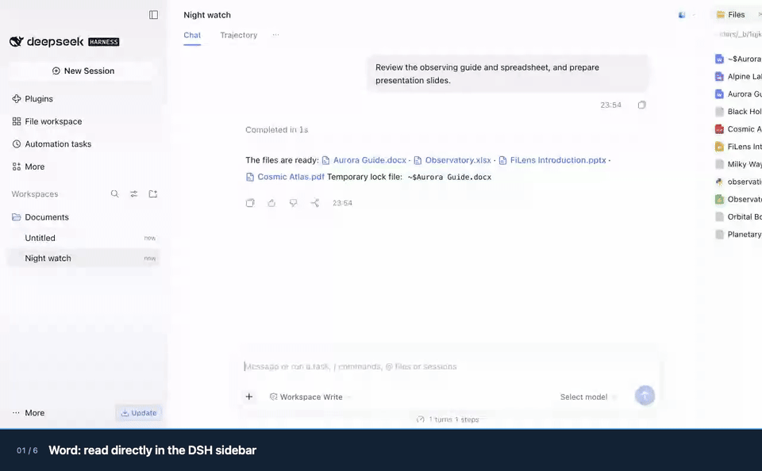
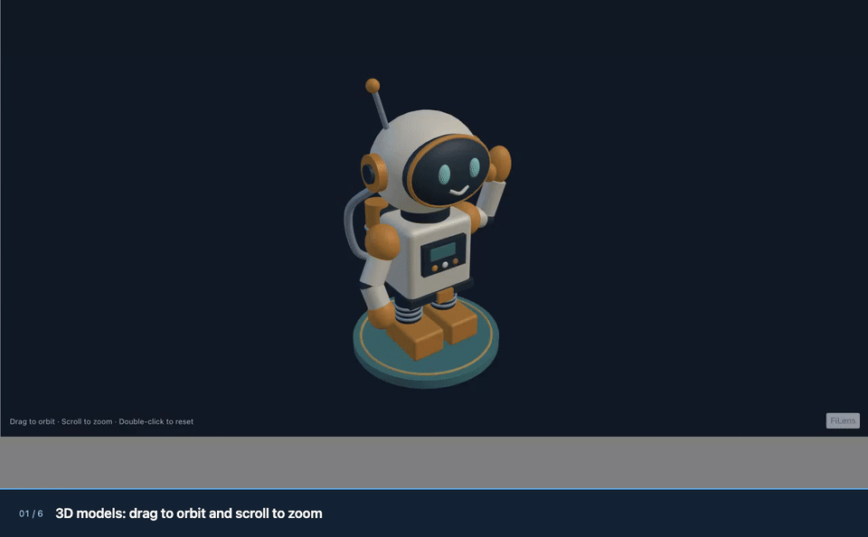
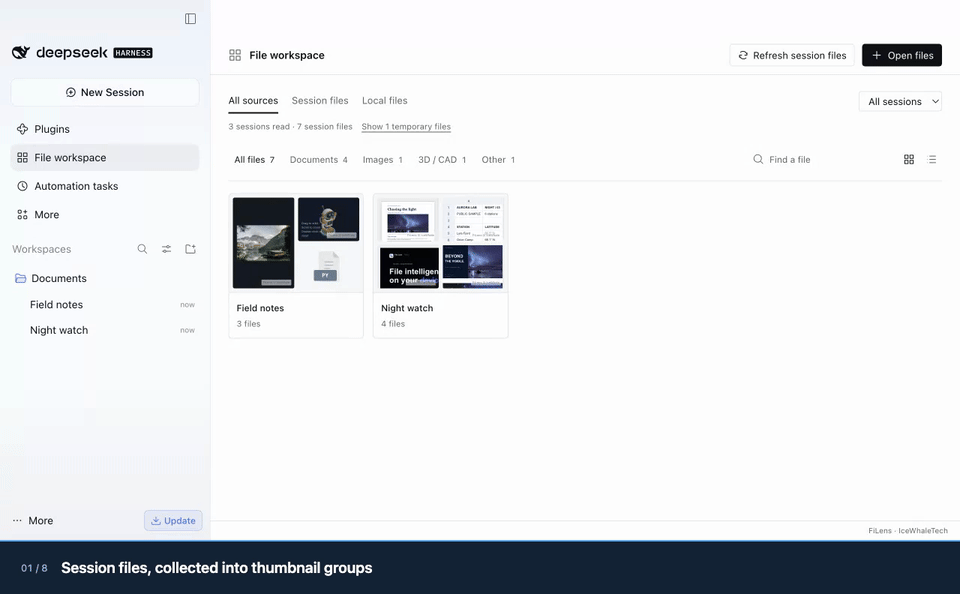

<div align="center">
  
  <h1>filens</h1>
  <p><strong>An Agent CLI. A pure frontend viewer for complex file formats.</strong></p>
  <p>Read, search, OCR, convert and preview local files. Files stay on your device.</p>
  <p>English · <a href="README.zh-CN.md">简体中文</a> · <a href="LICENSE">MIT</a></p>
</div>


[](apps/demo/public/home/filens-demo.mp4)

**Latest release: [v0.6.6](https://github.com/orca-zhang/filens/releases/tag/v0.6.6)** · CLI **0.5.6** · preview **0.3.6** · mobile SDKs **0.1.6** · DSH **0.1.9**.

[▶ Watch the 30-second walkthrough](apps/demo/public/home/filens-demo.mp4) · [Animated preview](docs/assets/readme/demo.gif) · [Format coverage and limits](docs/support-matrix.md)

| | Agent CLI | Pure frontend previews |
| --- | --- | --- |
| Use it for | Give Agents source text, search results, OCR and cited evidence; open a browser preview. | Preview Office, iWork, PDF, CAD / 3D, RAW, panoramas, archives and more in your app. |
| Supported formats (by extension) | **349**. | **450**, including direct previews and previews after local WASM conversion. |
| Approximate size | **Lite: 6.90–7.17 MiB (<10 MB) · Full: 31.26–33.80 MiB** offline downloads; Full includes preview assets, OCR runtime and models. Lite downloads preview assets separately. | **A few KB to hundreds of KB per compressed chunk**; shared dependencies, workers and WASM add to the total. An **all-in-one JS file** is also available. |
| Start here | [Install and use the CLI](#agent-cli) | [Preview and integrate](#pure-frontend-previews) |

The native executable is **0.92–2.20 MiB**. The CLI sizes above measure complete **v0.6.6 offline archive downloads**. Full includes preview **0.3.6**, OCR runtime and models; Lite retains reading, search and conversion with OCR/preview assets optional. Lite archives must stay strictly below **10,000,000 bytes (10 MB)**; packaging fails at or above that limit. See [archive and extracted sizes](docs/preview-release-sizes.json) (1 MiB = 1,048,576 bytes). npm CLI 0.5.6 component installations remain **8.00–9.27 MiB Lite / 31.43–37.06 MiB Full**, excluding Node.js, caches and preview assets. Frontend chunk figures describe compressed build artifacts. Preview 0.3.6 source-build main runtimes: **4.16 MB Brotli** summed across split files, or **3.40 MB Brotli / 3.54 MB gzip / 6.69 MB raw** for the supplied precompressed all-in-one JS. Optional archive WASM and worker add **0.36 MB Brotli / 0.46 MB gzip / 1.17 MB raw** to either build. Main runtimes include Vue, styles, document/image/STEP WASM and their workers. Media uses browser codecs with a small HEIC/HEIF decoder fallback. [CLI measurements](docs/agent-cli-npm-release.json) · [Standalone measurements](docs/preview-build-sizes.json).

Verified November 6, 2026: CLI **349** extensions; preview **450** source-file extensions (**451** route entries including internal `cad-json`). [Versions, counts and complete extension list](docs/release-v0.6.6-format-counts.json).

## Agent CLI

**Supports 349 file formats (counted by extension).** Read PDFs, Office documents, spreadsheets, scans and images locally. Search directories and nested archives; extract key original passages; find duplicate files and similar images. Outputs include text, JSON, Markdown, HTML, YAML, XML, CSV and TSV, with available page coordinates and document structure. Check `filens capacity --json` for your installation's capabilities; extraction fidelity varies by format. Paraphrasing, translation and question answering belong to the calling Agent.

### Installation and use

**Ask your Agent to install it:**

> Install filens for me. Find skills/filens/SKILL.md at https://github.com/orca-zhang/filens and follow it to set up the CLI and skill.

[Skill guide](skills/filens/SKILL.md) · For manual installation, download your platform’s offline bundle from the [latest Release](https://github.com/orca-zhang/filens/releases/latest) and extract the entire archive. Full includes offline preview assets, OCR and models. Lite keeps OCR and preview assets optional. Both run without Node.js or npm.

```sh
filens 'read "report.pdf" as json'
filens 'search "./documents" for "budget risk" as json'
filens summarize report.pdf --query 'budget risk' --json
filens convert report.doc report.docx

filens inspect unknown-file --json
filens capacity --json
```

`filens inspect FILE --json` identifies the actual format from bounded content reads, reports MIME/evidence and extension mismatches, and keeps ambiguous inputs explicit. It uses no OCR and does not validate the entire file.

### Offline browser previews

**CLI 0.5.6:** `filens preview report.pdf` creates a self-contained HTML with the source file, preview engine and licenses, opens it locally and exits. No server or file upload is needed. The v0.6.6 Full bundles include preview 0.3.6. With Lite, download and extract [the all-in-one runtime ZIP](https://github.com/orca-zhang/filens/releases/download/v0.6.6/filens-preview-0.3.6-all-in-one.zip), then pass `--assets /path/to/filens-preview-0.3.6-all-in-one` or set `FILENS_PREVIEW_DIR`. Copying its contents into `preview/` beside the executable also enables automatic discovery. npm CLI 0.5.6 retains preview 0.3.4; DSH 0.1.9 embeds preview 0.3.6; npm installations can prepare assets with `filens setup-preview`. The frontend package includes both builds and is measured separately: [package sizes](docs/preview-package-sizes.json).

```sh
# Export a portable offline preview; existing files are never overwritten
filens preview report.pdf --output report-preview.html --no-open
# Return the generated file URL and path as JSON
filens preview report.pdf --no-open --json
# Browser compatibility mode: loopback HTTP server, Ctrl-C to stop
filens preview report.pdf --mode serve
```

The HTML checks browser capabilities and blocks external resource requests. It contains a copy of the original file; temporary HTML files remain after exit. Safari/WebKit iWork previews require HTTP compatibility mode. [Preview setup and limits](packages/preview/README.md#cli-preview) · [Browser validation](docs/preview-html-validation.json).

### ZimaOS

**[ZimaOS ModStore](https://github.com/IceWhaleTech/Mod-Store/tree/main/builtin/filens):** install with `sudo zpkg install filens`. To upgrade, run `sudo zpkg update` and `sudo zpkg upgrade filens`. ModStore 0.5.1 includes the offline HTML preview engine for Linux x64/arm64 and always skips browser launching. Download or copy the generated HTML to your computer; `--json` returns its path on ZimaOS. Node.js and npm are not required. [Install, export previews and configure OCR](packaging/zimaos/README.md).

<details>
<summary>CLI sizes, capabilities and further examples</summary>

<!-- agent-cli-size:en:start -->
  <p><strong>CLI executable 2.20 MiB · Lite 7.17 MiB · Full 31.91 MiB · <a href="LICENSE">MIT</a></strong><br /><sub>v0.6.6 offline downloads · macOS arm64 · CLI 0.5.6; Full includes preview 0.3.6 and OCR models; Lite adds preview assets separately; <a href="docs/preview-release-sizes.json">all platform sizes</a></sub></p>
<!-- agent-cli-size:en:end -->

- [Installation, protocol and packaging](docs/agent-cli.md) · [Agent skill](skills/filens/SKILL.md)
- [Output formats and layouts](docs/agent-cli-formats-and-layout.zh-CN.md) · [68 observed examples and limits](docs/agent-cli-examples.zh-CN.md)
- [Search](docs/agent-cli-search.zh-CN.md), [nested archives](docs/agent-cli-search-archives.zh-CN.md) and [model-free key excerpts](docs/agent-cli-pruning.zh-CN.md)
- [Duplicates and similar images](docs/agent-cli-similarity.md) · [Windows setup and validation status](docs/agent-cli-windows.zh-CN.md)
- [Search coverage](docs/agent-cli-search-formats.zh-CN.md), [retrieval benchmarks](docs/agent-cli-search-benchmark.zh-CN.md) and [startup costs](docs/agent-cli-search-native.zh-CN.md)

The CLI uses Rust and the same frontend conversion core. Full bundles RapidOCR NCNN (max side 960, two OpenMP threads); Lite adds it with `filens setup-ocr`. Inspect `capacity` for the installed build's operations and conversion pairs. Natural-language requests recognize a bounded set of intents; use explicit `--pages` / `--slides` for selection. Field-specific questions are not implemented. Windows/Linux native execution remains pending validation.

**macOS OCR comparison:** Apple Vision is faster on the tested warm image calls, but loses tiny text and can be less accurate on blurred input; fresh-process latency is also higher. It cannot yet replace RapidOCR across this project's requirements. [Measurements, capability gaps and reproduction](docs/macos-ocr-benchmark.zh-CN.md).

</details>

## Pure frontend previews

**Preview 450 file formats in the browser with no upload or conversion server.** Counted by extension, including direct previews and previews after local WASM conversion. Browse Keynote slides, Pages pages and Numbers sheets; read Office and PDF documents; inspect CAD and 3D models; view RAW photos and 360° photos or video. See the [support matrix](docs/support-matrix.md) for coverage and limits by format.

### DeepSeek Harness

**Faster first previews than DSH built in: PPTX 13.56× · DOCX 16.46× · PDF 1.73×.**

| Typical file | DSH built in · first open | FiLens 0.1.3 · first open | Speedup |
| --- | ---: | ---: | ---: |
| PPTX presentation | 1,830 ms | **135 ms** | **13.56×** |
| DOCX document | 1,827 ms | **111 ms** | **16.46×** |
| PDF document | 329 ms | **190 ms** | **1.73×** |

Recorded November 5, 2026 on Apple M4 Pro/macOS and DSH Desktop 0.2.1-rc.5: nine paired rounds per format, medians through render readiness, excluding application startup. Office and PDF use separate runs; these are retained FiLens 0.1.3 measurements. PDF cached opens also improve from **110 to 77 ms (1.43×)**. [Office samples and method](docs/assets/dsh-plugin/performance-retest.zh-CN.md) · [PDF samples and method](docs/assets/dsh-plugin/pdf-reopen-optimization.zh-CN.md).

Install [`dsh-filens@0.1.9`](https://www.npmjs.com/package/dsh-filens) in **Plugins → Add plugin → Install → Enable now** for native sidebar previews of **450 formats**, plus local reading, OCR, search and conversion. [Setup and usage](integrations/deepseek-harness/README.md) · [3D / 360° gallery](docs/assets/dsh-plugin/README.md#3d-and-360-gallery) · [Measured comparisons](#performance-and-documentation).

<!-- dsh-package-metrics:start -->
**DSH 0.1.9: 5.81 MiB download / 17.58 MiB unpacked**, including the built-in workspace. CLI/OCR dependencies and DSH caches are separate. [Package measurements](docs/dsh-plugin-package.json).
<!-- dsh-package-metrics:end -->

**0.1.7 demos:** recorded in DSH Desktop with English UI and captions, using the local workspace candidate before the formal version bump. [Release notes, provenance and media](docs/releases/dsh-filens-0.1.8/README.md) · [Earlier public-package installation](docs/assets/dsh-plugin/README.md).



Rotate and zoom 3D models, look around 360° photos and play panoramic video in the same sidebar. [Full-color animated WebP](docs/assets/dsh-release/3d-and-panorama.en.webp) · [Full MP4](docs/assets/dsh-release/3d-and-panorama.en.mp4).



Version 0.1.9 includes **File workspace** in the same `dsh-filens` installation: session groups with real thumbnails, related files, and links back to the source message or question. Its switch is independent of sidebar Preview. Supports DSH **0.2.2-rc.1**, alongside the previously validated rc.5/alpha.3 versions.



### Browser integration: single file or split modules

**Preview 0.3.6:** split ZIP **5.62 MiB**, all-in-one ZIP **10.61 MiB**. Download from [v0.6.6](https://github.com/orca-zhang/filens/releases/tag/v0.6.6). Deploy the complete split directory, or choose the all-in-one JS build. Keep the archive sidecars to enable RAR / 7z.

npm: [filens-preview@0.3.6](https://www.npmjs.com/package/filens-preview/v/0.3.6), **16.22 MiB** download / **31.88 MiB** installed, including both builds. [Public registry checks](docs/preview-npm-registry-validation.json).

The same API is available in both builds. Vue, styles and the conversion engines are included; your app needs no Vue installation.

```html
<div id="preview" style="height: 80vh"></div>
<script type="module">
  // Deploy the entire extracted directory; the split build loads engines as needed.
  import { createPreview } from './filens.js';
  // The all-in-one build uses the same entry point with styles, WASM and workers included.
  // Keep the archive sidecars for RAR / 7z.

  const viewer = createPreview('#preview', { src: './report.pdf', name: 'report.pdf' });
  // viewer.update({ src: anotherFile, name: anotherFile.name });
  // viewer.destroy();
</script>
```

Deploy the extracted runtime directory and import its `filens.js` over HTTP(S). For a Vue app, use the shared [`Preview` component](packages/vue/README.md); for direct JavaScript integration and CLI previews, see the [standalone guide](packages/preview/README.md). Single-file packaging trades a larger initial download for simpler deployment; it has the same format limits as the split build.

### iOS / Android SDKs

**SDK 0.1.6 / preview 0.3.6:** iOS ZIP **5.64 MiB**, Android ZIP **5.65 MiB**.
Source SDKs are available as a local Swift Package and an Android
Library, sharing the offline frontend and WASM runtime. See the
[mobile SDK integration guide](sdk/README.md) and
[runtime, npm and SDK sizes](docs/preview-sizes.md).

### Format coverage

| Files | Preview | Main limits |
| --- | --- | --- |
| PPTX, Keynote / Pages / Numbers | Slide, page and worksheet canvases. | Fidelity varies by layout, fonts and objects. |
| DOCX, XLSX / CSV, PDF | Documents, sheets and paged PDFs. | Read-only; advanced styling may differ. |
| DOC / XLS / PPT, WPS / ET / DPS | Local WASM conversion for preview. | Preview-focused; macros are stripped. |
| PSD / PSB, AI / EPS / PS | Saved composite images or vector PDF. | 8-bit RGB/grayscale for Photoshop; bounded PostScript preview subset. [Design limits](docs/design-preview.md). |
| DXF, STEP / STP, mesh models | Pan drawings and orbit 3D geometry. | STEP omits source colors, names and assembly trees. |
| RAW, common images and icons | Embedded JPEG first, lightweight RAW development as fallback. | Camera coverage and image quality vary. |
| 360° photos and video | Interactive viewing and supported camera-original stitching. | Stitching is experimental; metadata, sidecars and browser codecs matter. |
| Archives, ebooks, code, mind maps and diagrams | Browse entries, chapters, source and node relationships. | Each format supports a documented subset. |

### Bundle sizes and loading costs

<details>
<summary>Detailed bundle sizes and loading costs</summary>

<!-- bundle-sizes:en:start -->
| Module / core | Raw | gzip | Brotli |
| --- | ---: | ---: | ---: |
| Conversion core WASM (Office detection) | 927.9 KiB | 414.3 KiB | **334.3 KiB** |
| Image / RAW core WASM | 2915.6 KiB | 940.3 KiB | **713.2 KiB** |
| Media / panorama preview | 465.1 KiB | 128.8 KiB | **108.3 KiB** |
| truck STEP WASM | 925.5 KiB | 326.4 KiB | **255.0 KiB** |

Document, image / RAW, and STEP WASM modules load independently on demand. Media preview and image conversion are measured separately. JS rows include their CSS; shared dependencies and workers are listed separately.

<details>
<summary>All modules and initial loading cost</summary>

| Module / core | Raw | gzip | Brotli |
| --- | ---: | ---: | ---: |
| Office decryption WASM (optional) | 370.6 KiB | 160.3 KiB | **127.4 KiB** |
| DWG reader WASM (on demand) | 886.8 KiB | 432.4 KiB | **351.8 KiB** |
| Raster preview WASM (on demand) | 1747.7 KiB | 717.4 KiB | **537.7 KiB** |
| PostScript WASM (optional) | 2429.4 KiB | 745.6 KiB | **516.0 KiB** |
| HEIC / HEIF decoder WASM | 1423.8 KiB | 470.2 KiB | **344.5 KiB** |
| Demo entry | 241.8 KiB | 69.5 KiB | **58.1 KiB** |
| Agent CLI demo UI | 34.9 KiB | 13.5 KiB | **11.1 KiB** |
| Shared vendor dependencies | 813.1 KiB | 229.7 KiB | **192.1 KiB** |
| PPTX / core runtime | 385.3 KiB | 108.2 KiB | **91.8 KiB** |
| Vue preview host | 247.2 KiB | 66.0 KiB | **52.5 KiB** |
| DOCX / XLSX / PDF | 51.7 KiB | 16.0 KiB | **14.4 KiB** |
| On-demand DOCX engine | 74.6 KiB | 20.1 KiB | **18.1 KiB** |
| Office attachments | 31.4 KiB | 12.1 KiB | **11.0 KiB** |
| Shared XML compatibility | 27.2 KiB | 8.9 KiB | **8.0 KiB** |
| Shared ZIP compatibility | 41.5 KiB | 12.7 KiB | **11.6 KiB** |
| Encrypted ZIP support | 99.1 KiB | 37.0 KiB | **32.3 KiB** |
| On-demand PDF engine | 435.2 KiB | 128.1 KiB | **106.9 KiB** |
| iWork preview | 40.5 KiB | 12.1 KiB | **10.8 KiB** |
| CAD / mind maps / diagrams | 100.6 KiB | 28.4 KiB | **24.4 KiB** |
| 3D preview | 109.0 KiB | 31.7 KiB | **27.7 KiB** |
| glTF / GLB model loader | 42.7 KiB | 12.6 KiB | **11.2 KiB** |
| FBX model loader | 43.9 KiB | 14.1 KiB | **12.6 KiB** |
| OBJ model loader | 8.5 KiB | 2.9 KiB | **2.6 KiB** |
| MTL model loader | 4.2 KiB | 1.7 KiB | **1.5 KiB** |
| 3DS model loader | 8.4 KiB | 2.8 KiB | **2.5 KiB** |
| LDraw model loader | 24.0 KiB | 8.3 KiB | **7.3 KiB** |
| USDZ model loader | 8.5 KiB | 2.6 KiB | **2.4 KiB** |
| VRML model loader | 178.0 KiB | 46.4 KiB | **39.8 KiB** |
| Media decoder loader | 143.1 KiB | 52.5 KiB | **45.5 KiB** |
| Archive preview | 48.1 KiB | 14.6 KiB | **13.1 KiB** |
| RAR / 7z extraction WASM (optional) | 1089.9 KiB | 429.8 KiB | **332.3 KiB** |
| Archive worker (optional) | 51.5 KiB | 18.2 KiB | **16.3 KiB** |
| Text / ebooks | 18.1 KiB | 6.9 KiB | **6.1 KiB** |
| iWork worker | 884.9 KiB | 183.4 KiB | **153.3 KiB** |
| PDF worker | 1053.3 KiB | 291.1 KiB | **233.1 KiB** |
| truck STEP loader | 2.8 KiB | 1.4 KiB | **1.2 KiB** |

Entry, preloaded JS, and CSS total **461.8 KiB Brotli** (1946.8 KiB raw / 548.9 KiB gzip), plus images, video, and samples. Modules share dependencies; these rows are not standalone per-format download totals.

</details>

Measured from the demo build. Compression columns describe artifacts; actual transfer depends on hosting. [Full report and reproduction](docs/bundle-sizes.md).
<!-- bundle-sizes:en:end -->

The [format package audit](docs/format-package-sizes.md) records dependency sharing,
worker packaging and measured savings for applications combining the npm libraries.

The [DWG optimization audit](docs/dwg-preview-optimization.md) records the compact CAD reader (443 KB gzip), direct drawing-model loading, and measurements across 13 drawings; the reader is included in the build measurements above.

The table above measures the v0.6.6 production demo build. The new standalone builds have their own [complete measurements](docs/preview-build-sizes.json), including embedded dependencies. Individual chunks are not independent per-format download totals.

</details>

### Frontend project comparisons

<details>
<summary>Frontend project comparisons</summary>

| Frontend project | iWork | 360° photos / video | RAW preview | Native PPTX | CAD / 3D |
| --- | --- | --- | --- | --- | --- |
| **filens** | **✅ All three** | **✅** | **◐** | **✅** | **✅** |
| [SheetJS CE](https://docs.sheetjs.com/docs/miscellany/formats/) | ◐ Numbers | — | — | — | — |
| [Photo Sphere Viewer](https://github.com/mistic100/Photo-Sphere-Viewer) | — | ✅ | — | — | — |
| [LibRaw-Wasm](https://github.com/ybouane/LibRaw-Wasm) | — | — | ✅ | — | — |
| [vue-office](https://github.com/501351981/vue-office) | — | — | — | ✅ | — |
| [PPTist](https://github.com/pipipi-pikachu/PPTist) | — | — | — | ✅ | — |
| [Online 3D Viewer](https://github.com/kovacsv/Online3DViewer) | — | — | — | — | ✅ |

<sub>✅ Available path · ◐ Partial or conditional support · — No built-in path documented. [Format coverage and limits](docs/support-matrix.md).</sub>

**iWork, panoramas, RAW, Office, and CAD / 3D in one browser-local workspace.** The projects above specialize in different areas; filens brings these previews together.

<details>
<summary>Comparison notes and support boundaries</summary>

- Entries follow public documentation and browser-local processing paths, rather than overall project rankings. Support and fidelity vary by file.
- **iWork / PPTX:** filens previews Keynote, Pages, and Numbers natively. SheetJS extracts Numbers table data and needs an application UI. PPTist imports PPTX into its presentation model; vue-office's [PPTX core is not open source](https://github.com/501351981/pptx-preview#关于授权).
- **Panoramas:** both filens and Photo Sphere Viewer display photos and video. filens also handles supported X5 INSP originals, Insta360 / DJI calibration and distortion, original-track synchronization, and calibrated DNG stitching. Camera-original stitching is experimental and depends on metadata, companion files, and browser codecs. PSV's [generic dual-fisheye adapter](https://photo-sphere-viewer.js.org/guide/adapters/dual-fisheye.html) does not parse X5 calibration.
- **RAW:** filens prioritizes embedded JPEGs, then lightweight sensor development. LibRaw-Wasm offers full / half-size decoding and development through an API that needs an application UI. These paths have different image-quality goals.
- **CAD / 3D:** filens covers DXF, STEP, and mesh previews. Online 3D Viewer specializes in model viewing, inspection, and export, including STEP / IGES / IFC. filens STEP previews retain geometry and instance placement, but omit source colors, names, and the assembly tree.

</details>

</details>

## Run the demo locally

Requires Node.js 20+ and [Rust via rustup](https://rustup.rs/). The repository pins the Rust compiler and WASI target.

```sh
npm ci
npm run build:wasm
npm run dev --workspace @filens/demo
```

Open [the local demo](http://localhost:5173/modules/filens/?lang=en) (requires local deployment; otherwise, open [the Vercel online demo](https://filens-six.vercel.app/?lang=en)), then choose a sample or drop in a file. For hosting, see the [Vercel guide](docs/deploy-vercel.md).

## Install on ZimaOS

<p align="center"><a href="https://www.zimaspace.com/en/zimaos?utm_source=github&amp;utm_medium=referral&amp;utm_campaign=filens_zimaos&amp;utm_content=readme_banner_en"></a></p>

Install FiLens from the official Mod Store. In the ZimaOS terminal or over SSH, run:

```sh
sudo zpkg install filens
```

This installs the native CLI and shared WASM engines for Linux x64/arm64, with no Node.js dependency. Run `filens capacity --json`, then `filens read report.pdf --json`. OCR reuses Photos' installed NCNN v7 runtime and RapidOCR models. If they are absent or incompatible, `filens setup-ocr` installs a compatible private copy; document reading and conversion work without OCR.

On ZimaOS, `filens preview report.pdf --output report-preview.html --json` exports an HTML without launching a browser. Download or copy it to your computer to open it. HTTP compatibility mode requires an SSH tunnel to the loopback port.

If the module is not found, run `sudo zpkg update` to refresh the store index, then retry. See the [ZimaOS packaging guide](packaging/zimaos/README.md) for building, publishing and updating the package.

## Performance and documentation

HEIF decoder source versions, rebuild steps, and Apple-edited 10-bit color regression:
[HEIF decoder build](packages/converter-client/vendor/libheif/README.md).

<details>
<summary>Show SOTA benchmark results</summary>

Updated November 5, 2026. **12 measured scenarios** cover DSH, XLSX, ZIP, PPTX, RAW and STEP. Each workload shows its latest recorded FiLens result against the named baseline; measurement dates and stages are stated. Tiny examples and marginal gains remain in the full reports.

**Complete DSH sidebar previews**

| Sample · first / cached median (ms) | FiLens 0.1.3 | DSH built in | First-open speedup |
| --- | ---: | ---: | ---: |
| PPTX | **135 / 81** | 1830 / 124 | **13.56×** |
| DOCX | **111 / 94** | 1827 / 112 | **16.46×** |
| PDF | **190 / 77** | 329 / 110 | **1.73×** |

Ratios in this table describe first opens. PDF cached opens improve **1.43×** (110 → 77 ms). Office and PDF use separate nine-round paired measurements.

**Large-input parsing against specialized libraries**

| Larger parsing workload | Baseline | Baseline / FiLens median (ms) | Speedup |
| --- | --- | ---: | ---: |
| XLSX · 2,000 × 64, 128,000 cells | SheetJS CE 0.20.3 | 150.94 / **61.72** | **2.45×** |
| XLSX · 8,000 × 64, 512,000 cells | SheetJS CE 0.20.3 | 615.71 / **213.50** | **2.88×** |
| ZIP · 10,000 entries, 18.34 MiB expanded | JSZip 3.10.1 | 700.55 / **55.52** | **12.62×** |
| ZIP · 2,500 entries, 36.23 MiB expanded | JSZip 3.10.1 | 247.99 / **95.37** | **2.60×** |

Nine measured rounds after two warmups, alternating library order; all cell values or complete entry texts verified. These parser timings exclude rendering, imports, network and verification. The DSH rows include preview rendering. Results are limited to the named workloads and baselines; they do not establish a universal ranking or identical feature coverage. [Methods, versions, raw samples and reproduction](docs/featured-performance.md) · [Historical comparisons](docs/performance-comparison.md).

**PPTX, RAW and STEP: latest recorded browser comparisons**

| Workload | FiLens (ms) | Baseline (ms) | Speedup | Measured |
| --- | ---: | --- | ---: | --- |
| PPTX · 11.1 MB, 13 slides, complete parse | **28.5** | pptx-preview 1.0.7: 56.6 | **1.99×** | Oct 23–24 |
| NEF · Nikon D3S, sensor → preview canvas | **152.7** | LibRaw-Wasm 1.6.0 half-size: 326.7 | **2.14×** | Oct 23–24 |
| DNG · Pentax K-r, sensor → preview canvas | **167.7** | LibRaw-Wasm 1.6.0 fast half-size: 314.4 | **1.87×** | Oct 23–24 |
| STEP · as1_pe_203 assembly, geometry import | **61.2** | occt-import-js 0.0.23: 195.0 | **3.19×** | Nov 1 |
| STEP · tailturbine, geometry import | **50.6** | occt-import-js 0.0.23: 153.9 | **3.04×** | Nov 1 |

All dates are in 2026. RAW inputs have no embedded JPEG; preview resolution/tone differs from LibRaw. STEP compares parsing/tessellation and validated geometry, with different triangulations; scene construction and drawing are excluded. PPTX measures complete parsing. These are the latest recorded runs for each workload, with inputs/modules ready before timing. [Browser methods, confidence intervals and raw evidence](docs/performance-comparison.md).

</details>

| Looking for… | Start here |
| --- | --- |
| Standalone single-file / split builds and CLI preview | [Preview guide](packages/preview/README.md) |
| Vue integration | [Vue components](packages/vue/README.md) |
| Supported formats | [Support matrix](docs/support-matrix.md) |
| Browser media without a conversion server | [Integration, limits and validation](docs/browser-media-engine.md) |
| Architecture and WASM boundaries | [Project overview](docs/project-overview.md) |
| Frontend benchmarks and raw data | [Performance comparison](docs/performance-comparison.md) |
| macOS native OCR vs RapidOCR | [Measured comparison](docs/macos-ocr-benchmark.zh-CN.md) |
| CLI and backend integration | [Agent CLI](docs/agent-cli.md) · [Go + wazero host](examples/go-wazero-converter/README.md) |

Try your files and [report a reproducible issue](https://github.com/orca-zhang/filens/issues/new/choose). [Roadmap](docs/roadmap.md) · [MIT license](LICENSE) · [Third-party notices](packaging/agent-third-party.md).

<sub>Preview captures come from filens. Photos and demo recordings retain their original licenses; see <a href="docs/assets/readme/SOURCES.md">visual sources and credits</a>. iWork research: <a href="https://github.com/dunhamsteve/iwork">dunhamsteve/iwork</a>; CAD lineage: <a href="https://github.com/orcastor/cad2x-converter">orcastor/cad2x-converter</a>.</sub>

## Star History

[](https://star-history.com/#orca-zhang/filens&Date)
