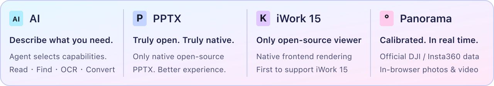
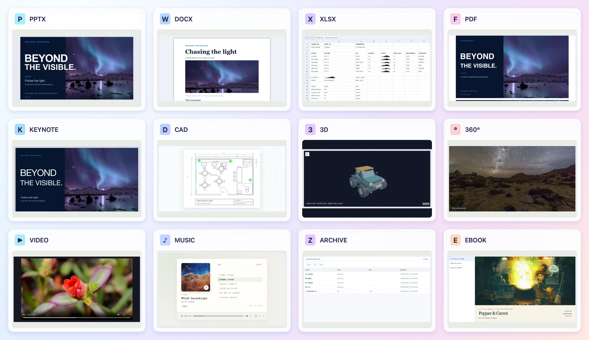
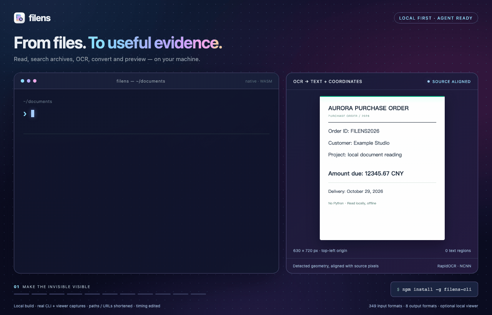
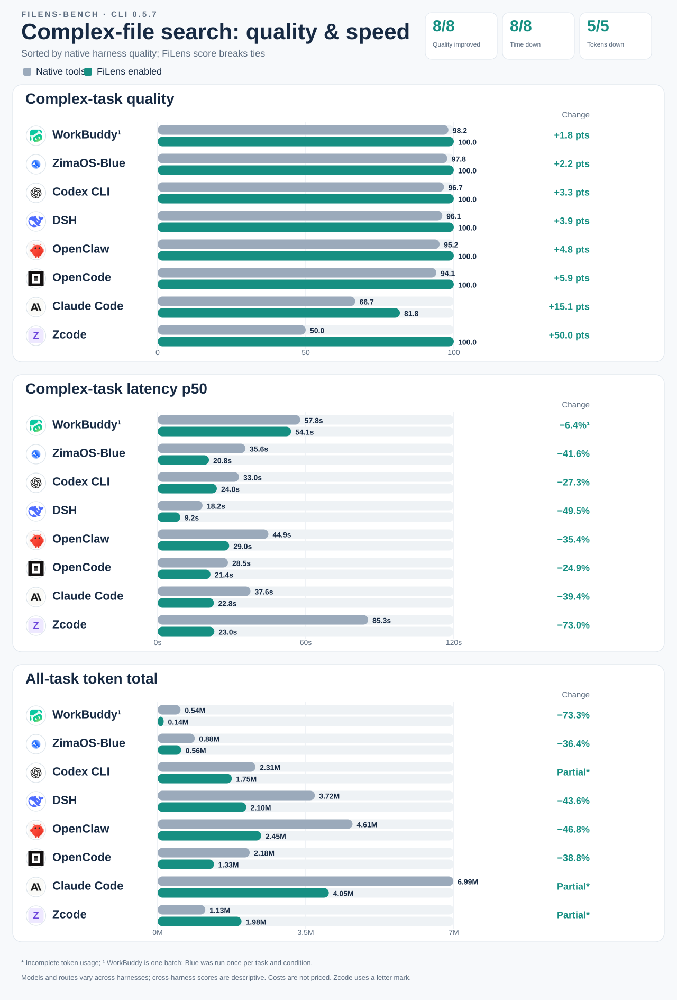
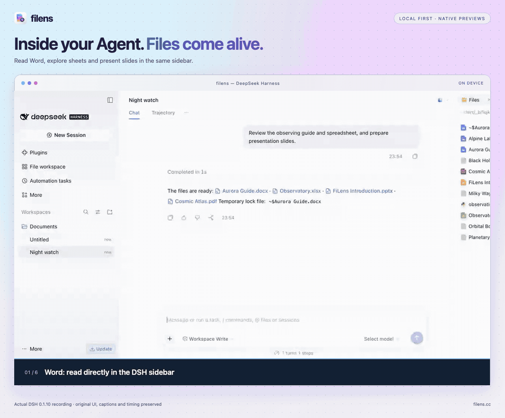
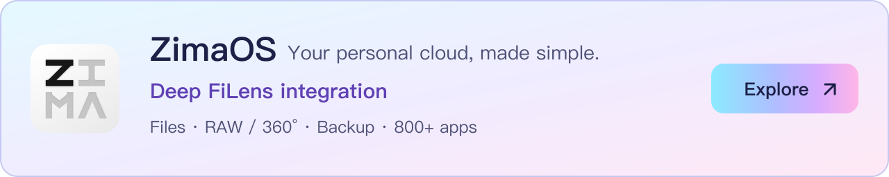

<div align="center">
  
  <h1>filens</h1>
  <p><strong>An Agent CLI. A pure frontend viewer for complex file formats.</strong></p>
  <p>Read, search, OCR, convert and preview local files. Files stay on your device.</p>
  <p>
    <a href="docs/project-overview.md#what-makes-filens-different">
      <picture>
        <source media="(max-width: 600px)" srcset="docs/assets/readme/highlights-mobile.en.png" />
        
      </picture>
    </a>
  </p>
  <p><sub>To our knowledge, as of November 24, 2026 · <a href="docs/project-overview.md#what-makes-filens-different">Capabilities and measurements</a></sub></p>
  <p>English · <a href="README.zh-CN.md">简体中文</a> · <a href="LICENSE">MIT</a> · <a href="https://filens.cc/bench/en.html">FiLens-Bench</a></p>
</div>

**Latest release: [v0.6.8](https://github.com/orca-zhang/filens/releases/tag/v0.6.8)** · CLI **0.5.8** · preview **0.3.8** · mobile SDKs **0.1.9** · DSH **0.1.12**.

| | Agent CLI | Pure frontend previews |
| --- | --- | --- |
| Use it for | Give Agents source text, search results, OCR and cited evidence. | Preview Office, iWork, PDF, CAD / 3D, RAW, panoramas and more in your app. |
| Format coverage | **349** | **450**, including previews after local WASM conversion. |
| Archive size | **Lite 7.09–7.72 MiB · Full 24.87–27.48 MiB** | **Split-only npm 5.64 MiB · dual-build npm 9.76 MiB** |
| Start here | [Install the CLI](#agent-cli) | [Integrate previews](#pure-frontend-previews) · [Try online](https://filens.cc/?lang=en) |

Formats are counted by source-file extension; [inventory](docs/release-v0.6.6-format-counts.json) verified November 24, 2026. Sizes: [CLI platforms](docs/release-v0.6.8.md#downloads) · [Preview packages](docs/preview-sizes.md).

[](apps/demo/public/home/filens-demo.mp4)

[▶ Watch the 30-second walkthrough](apps/demo/public/home/filens-demo.mp4) · [Animated preview](docs/assets/readme/preview.gif) · [Format coverage and limits](docs/support-matrix.md)

## Agent CLI

Read local documents, search directories and nested archives, extract key original passages, and find duplicate files or similar images. Output JSON, Markdown, CSV and more, retaining available page references, coordinates and document structure. The calling Agent handles summarization, translation and question answering.

**Ask your Agent to install it:**

> Install filens for me. Read https://filens.cc/skills/filens/SKILL.md and follow it to set up the CLI and skill. Offline packages: https://filens.cc/downloads/.

Or get your platform's offline bundle from the [official downloads](https://filens.cc/downloads/) and extract the entire archive. No Node.js or npm is required. Full includes offline preview, OCR and models; Lite adds them as needed.

```sh
filens 'read "report.pdf" as json'
filens 'search "./documents" for "budget risk" as json'
filens summarize report.pdf --query 'budget risk' --json
filens convert report.doc report.docx
filens inspect unknown-file --json
filens capacity --json
```

`inspect` identifies the actual format through bounded content reads; it does not validate the entire file. Check `capacity` for installed capabilities. See the [CLI guide](docs/agent-cli.md) and [observed examples](docs/agent-cli-examples.zh-CN.md) for natural-language scope and extraction limits.

### Export an offline preview

```sh
filens preview report.pdf --output report-preview.html --no-open
```

Creates a self-contained HTML with the original file, preview engine and licenses. Copy it to another computer to open offline; existing files are never overwritten. Omit `--no-open` to open it automatically. Safari/WebKit iWork previews require `--mode serve`. See [preview setup](packages/preview/README.md#cli-preview) for Lite assets.



### FiLens-Bench: Agent results

Across 13 synthetic tasks and eight paired agent harnesses, installing FiLens CLI **0.5.7** improved quality in **8/8** pairs, reduced recorded time in **8/8**, and reduced tokens in **5/5** pairs with complete usage. Tasks cover Office, PDFs, nested archives, scans, cross-file questions and unanswerable queries. Models vary across harnesses; compare within each pair.

[](https://filens.cc/bench/en.html)

[Official results site](https://filens.cc/bench/en.html) · [Bilingual scorecard](benchmarks/filens-bench/published/converged-2026-11-24/README.md) · [Method and reproduction](benchmarks/filens-bench/README.zh-CN.md)

## Pure frontend previews

Parse and render locally in the browser, with no upload or conversion server. View PPTX, Keynote, Pages and Numbers natively, alongside Office / PDF, CAD / 3D, design files, RAW, 360° photos and video, archives, ebooks and more. Format modules and WASM load on demand; CLI, Web and mobile share the same conversion core.

### Browser integration

Install the split package in a frontend project such as Vite. Your app needs no separate Vue installation:

```sh
npm install filens-preview-split
```

```html
<div id="preview" style="height: 80vh"></div>
<script type="module">
  import { createPreview } from 'filens-preview-split';

  const viewer = createPreview('#preview', { src: './report.pdf', name: 'report.pdf' });
  // Change files: viewer.update({ src: anotherFile, name: anotherFile.name });
  // On unmount: viewer.destroy();
</script>
```

Or get a standalone runtime from [Releases](https://github.com/orca-zhang/filens/releases/tag/v0.6.8), deploy its complete directory and import `filens.js` over HTTP(S). Split and all-in-one builds share the same API; keep the archive sidecars for RAR / 7z. [Standalone guide](packages/preview/README.md) · [Vue components](packages/vue/README.md).

Previews are read-only; layout and font fidelity vary by file. Camera-original stitching is experimental. See the [support matrix](docs/support-matrix.md) for format boundaries.

### iOS / Android SDKs

Swift Package and Android Library source SDKs wrap the same offline runtime, with file loading, render/error callbacks and cleanup. **Version 0.1.9 source SDK ZIPs are each smaller than 3 MiB**, retaining all offline formats. Run `node prepare-runtime.mjs` once on the developer computer before integration; Node.js 18+ and a C++17 compiler are required. [Integration guide](sdk/README.md) · [Exact sizes](docs/mobile-sdk-sizes.json).

## Ready-made integrations

### DeepSeek Harness

Enter [`dsh-filens@0.1.12`](https://www.npmjs.com/package/dsh-filens) in **Plugins → Add plugin → Install → Enable now**. One plugin provides native sidebar previews, local reading / OCR / search / conversion, and a file workspace with thumbnails, related files and links to source messages.



[Setup and usage](integrations/deepseek-harness/README.md) · [3D / 360° demo](docs/assets/dsh-release/3d-and-panorama.en.gif?v=branding-20261114) · [File workspace demo](docs/assets/dsh-release/file-workspace.en.gif?v=branding-20261114) · [Recording provenance](docs/releases/dsh-filens-0.1.8/README.md)

**First-open performance on representative samples:**

| File | DSH built in | FiLens 0.1.11 | Speedup |
| --- | ---: | ---: | ---: |
| PPTX | 1,325 ms | **126 ms** | **10.52×** |
| DOCX | 1,312 ms | **108 ms** | **12.15×** |
| PDF | 343 ms | **200 ms** | **1.72×** |

Measured November 24, 2026 on Apple M4 Pro/macOS, DSH Desktop 0.2.3-alpha.2: nine paired rounds per format, median through render readiness plus two frames, excluding app startup. Cached PDF opens are equal. Version 0.1.12's renderer and workspace match the measured version. [Samples, cache conditions and method](docs/assets/dsh-plugin/performance-0.1.11.md).

### ZimaOS

<p align="center"><a href="https://www.zimaspace.com/en/zimaos?utm_source=github&amp;utm_medium=referral&amp;utm_campaign=filens_zimaos&amp;utm_content=readme_banner_en"></a></p>

Install from the official Mod Store for Linux x64/arm64; no Node.js required:

```sh
sudo zpkg install filens
```

`filens preview report.pdf --output report-preview.html --json` exports HTML without opening a browser. Download or copy it to your computer to view it. OCR reuses compatible Photos components; run `filens setup-ocr` if needed. [Installation, updates and OCR setup](packaging/zimaos/README.md).

## Local development

Requires Node.js 20+ and [Rust via rustup](https://rustup.rs/). The repository pins the Rust compiler and WASI target.

```sh
npm ci
npm run build:wasm
npm run dev --workspace @filens/demo
```

Open [the local demo](http://localhost:5173/modules/filens/?lang=en), then choose a sample or drop in a file. [Deployment guide](docs/deploy-vercel.md).

## Documentation

| Looking for… | Start here |
| --- | --- |
| CLI commands, output and search | [CLI guide](docs/agent-cli.md) · [Output formats](docs/agent-cli-formats-and-layout.zh-CN.md) · [Search](docs/agent-cli-search.zh-CN.md) · [Duplicates and similar images](docs/agent-cli-similarity.md) |
| Format coverage and architecture | [Support matrix](docs/support-matrix.md) · [Architecture and comparisons](docs/project-overview.md) · [WASM conversion core](wasm/converter-core-rust/README.md) |
| Performance and raw data | [Selected measurements](docs/featured-performance.md) · [Frontend comparisons](docs/performance-comparison.md) · [OCR comparison](docs/macos-ocr-benchmark.zh-CN.md) |
| Package sizes and loading costs | [Preview and SDKs](docs/preview-sizes.md) · [Frontend bundles](docs/bundle-sizes.md) · [CLI platforms](docs/agent-cli-npm-release.json) |
| Browser media compatibility | [Integration, limits and validation](docs/browser-media-engine.md) |

Try your files and [report a reproducible issue](https://github.com/orca-zhang/filens/issues/new/choose). [Roadmap](docs/roadmap.md) · [MIT license](LICENSE) · [Third-party notices](packaging/agent-third-party.md).

<sub>Preview captures come from filens. Photos and demo recordings retain their original licenses; see <a href="docs/assets/readme/SOURCES.md">visual sources and credits</a>. iWork research: <a href="https://github.com/dunhamsteve/iwork">dunhamsteve/iwork</a>; CAD lineage: <a href="https://github.com/orcastor/cad2x-converter">orcastor/cad2x-converter</a>.</sub>

## Star History

[](https://star-history.com/#orca-zhang/filens&Date)
