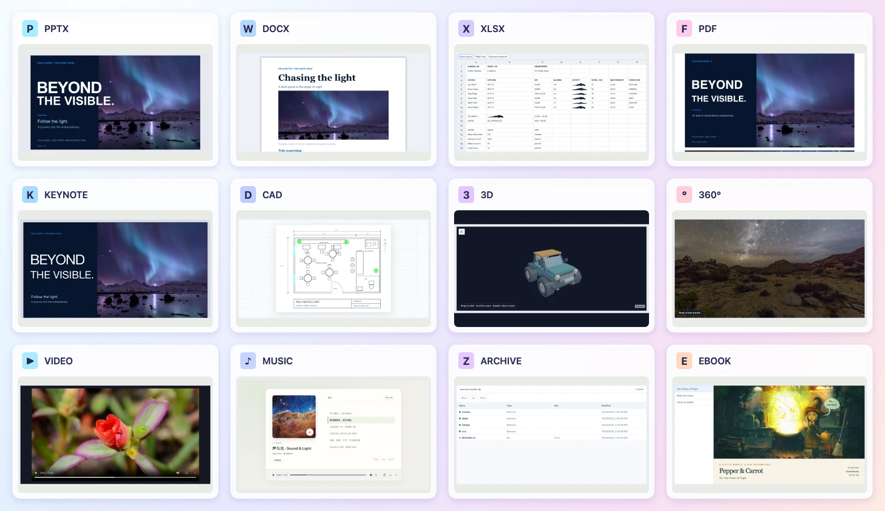
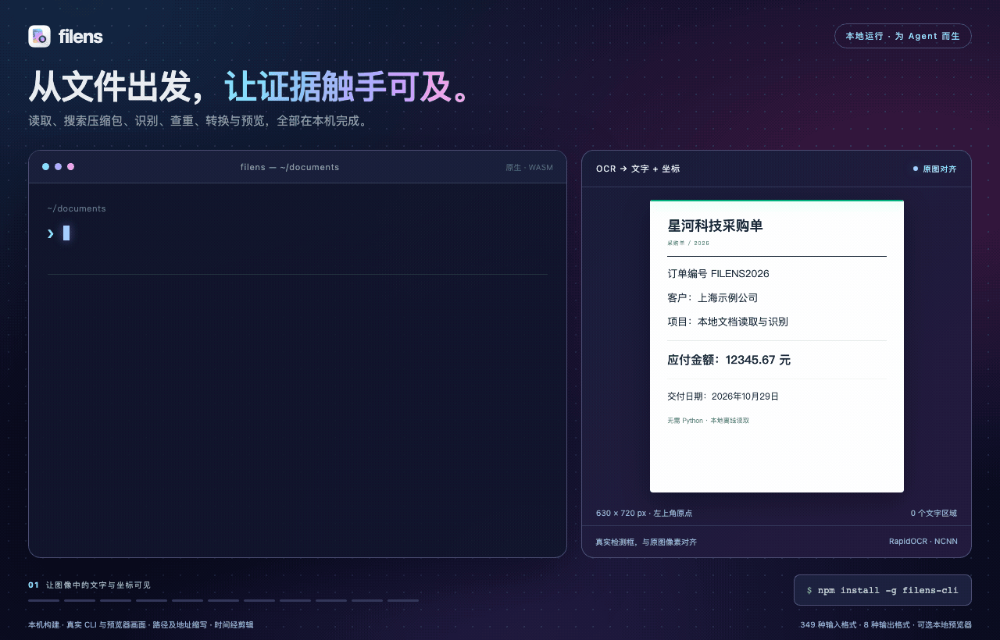
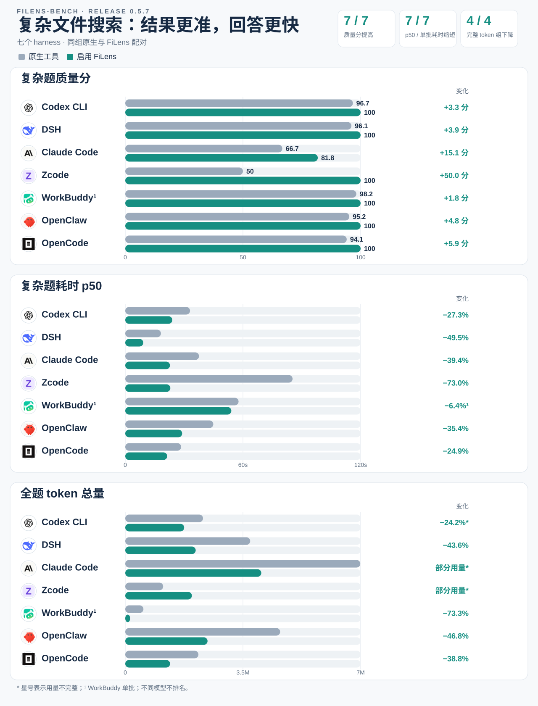

<div align="center">
  
  <h1>探微 · filens</h1>
  <p><strong>给 Agent 的 CLI，也是一套纯前端复杂格式预览工具。</strong></p>
  <p>本地读取、搜索、OCR、转换与预览，文件无需上传。</p>
  <p>
    <a href="docs/project-overview.zh-CN.md#filens-的独特能力">
      <picture>
        <source media="(max-width: 600px)" srcset="docs/assets/readme/highlights-mobile.zh-CN.png" />
        
      </picture>
    </a>
  </p>
  <p><sub>据我们所知，截至 2026-11-24 · <a href="docs/project-overview.zh-CN.md#filens-的独特能力">能力与实测</a></sub></p>
  <p><a href="README.md">English</a> · 简体中文 · <a href="LICENSE">MIT</a> · <a href="https://filens.cc/bench/">FiLens-Bench</a></p>
</div>

**最新版本：[v0.6.8](https://github.com/orca-zhang/filens/releases/tag/v0.6.8)** · CLI **0.5.8** · 预览 **0.3.8** · 移动端 SDK **0.1.9** · DSH **0.1.12**。

| | Agent CLI | 纯前端预览 |
| --- | --- | --- |
| 用途 | 向 Agent 提供原文、搜索结果、OCR 与可定位证据。 | 在应用中预览 Office、iWork、PDF、CAD / 3D、RAW、全景等文件。 |
| 格式覆盖 | **349 种** | **450 种**，含本地 WASM 转换后预览。 |
| 压缩下载体积 | **Lite 7.09–7.72 MiB · Full 24.87–27.48 MiB** | **npm 分包版 5.64 MiB · 完整版 9.76 MiB** |
| 开始使用 | [安装 CLI](#agent-cli) | [接入预览](#纯前端预览) · [在线体验](https://filens.cc/?lang=zh) |

格式按源文件扩展名统计，[清单](docs/release-v0.6.6-format-counts.json)核对日期为 2026-11-24。体积见 [CLI 各平台](docs/release-v0.6.8.md#downloads)与[预览包实测](docs/preview-sizes.md)。

[](apps/demo/public/home/filens-demo.mp4)

[▶ 观看 30 秒演示](apps/demo/public/home/filens-demo.mp4) · [预览动图](docs/assets/readme/preview.gif) · [完整格式与限制](docs/support-matrix.zh-CN.md)

## Agent CLI

本地读取文档、搜索目录与嵌套压缩包、提取关键原文、查找重复文件与相似图片。支持 JSON、Markdown、CSV 等输出，保留可用的页码、坐标与文档结构；总结、翻译和问答由调用它的 Agent 完成。

**把这句话发给你的 Agent：**

> 帮我安装 filens，读取 https://filens.cc/skills/filens/SKILL.md，按里面的说明配置 CLI 和 Skill。离线安装包：https://filens.cc/downloads/。

也可从[官网下载页](https://filens.cc/downloads/)下载对应平台的离线包并完整解压，无需 Node.js 或 npm。Full 自带离线预览、OCR 与模型；Lite 按需补充。

```sh
filens '读取 "report.pdf"，以 JSON 输出'
filens '在 "./documents" 中搜索 "预算 风险"，以 JSON 输出'
filens summarize report.pdf --query '预算 风险' --json
filens convert report.doc report.docx
filens inspect unknown-file --json
filens capacity --json
```

`inspect` 通过有界内容读取识别实际格式，不代表完整文件校验。当前安装版本的能力以 `capacity` 为准；自然语言支持范围与提取保真度见[CLI 指南](docs/agent-cli.zh-CN.md)和[实测案例](docs/agent-cli-examples.zh-CN.md)。

### 导出离线预览

```sh
filens preview report.pdf --output report-preview.html --no-open
```

生成包含原文件、预览引擎和许可的独立 HTML，可复制到其他电脑离线打开，不覆盖已有文件。省略 `--no-open` 可自动打开；Safari / WebKit 的 iWork 预览需使用 `--mode serve`。Lite 的资源配置见[预览指南](packages/preview/README.md#cli-preview)。



### FiLens-Bench：Agent 使用效果

在 13 道合成题、8 个 agent harness 的配对评测中，安装 FiLens CLI **0.5.7** 后，**8/8** 组质量分提高、**8/8** 组记录耗时缩短，用量完整的 **5/5** 组 token 总量下降。覆盖 Office、PDF、嵌套压缩包、扫描件、跨文件与无答案问题；模型因 harness 而异，应比较同组结果。

[](https://filens.cc/bench/)

[官方评测站](https://filens.cc/bench/) · [中英文成绩表](benchmarks/filens-bench/published/converged-2026-11-24/README.md) · [方法与复现](benchmarks/filens-bench/README.zh-CN.md)

## 纯前端预览

在浏览器本地解析和渲染，无需上传或转换服务器。原生浏览 PPTX、Keynote、Pages、Numbers，读取 Office / PDF，查看 CAD / 3D、设计文件、RAW、360° 照片与视频、压缩包、电子书等。格式模块与 WASM 按需加载，CLI、Web 与移动端复用同一转换核心。

### 浏览器接入

在 Vite 等前端项目中安装分包版，宿主无需额外安装 Vue：

```sh
npm install filens-preview-split
```

```html
<div id="preview" style="height: 80vh"></div>
<script type="module">
  import { createPreview } from 'filens-preview-split';

  const viewer = createPreview('#preview', { src: './report.pdf', name: 'report.pdf' });
  // 更换文件：viewer.update({ src: anotherFile, name: anotherFile.name });
  // 卸载时：viewer.destroy();
</script>
```

也可从 [Release](https://github.com/orca-zhang/filens/releases/tag/v0.6.8) 下载独立运行时，部署完整目录并通过 HTTP(S) 导入 `filens.js`。分包版与单 JS 版 API 相同；RAR / 7z 需保留配套资源。[独立 JS 接入](packages/preview/README.md) · [Vue 组件](packages/vue/README.md)。

预览为只读，布局与字体保真度因文件而异；相机原片拼接为实验性能力。各格式边界见[支持矩阵](docs/support-matrix.zh-CN.md)。

### iOS / Android SDK

Swift Package 与 Android Library 源码 SDK 封装同一离线运行时，提供文件加载、渲染 / 错误回调与资源释放。**0.1.9 的完整源码 SDK ZIP 均小于 3 MiB**，保留全部离线格式；接入前在开发机运行一次 `node prepare-runtime.mjs`，需要 Node.js 18+ 与 C++17 编译器。[接入指南](sdk/README.zh-CN.md) · [精确体积](docs/mobile-sdk-sizes.json)。

## 现成集成

### DeepSeek Harness

在「插件 → 添加插件」中填写 [`dsh-filens@0.1.12`](https://www.npmjs.com/package/dsh-filens)，点击「安装 → 立即启用」。一个插件提供原生侧栏预览、本地读取 / OCR / 搜索 / 转换，以及带缩略图、相关文件和原消息定位的文件工作台。


[安装与使用](integrations/deepseek-harness/README.zh-CN.md) · [3D / 全景演示](docs/assets/dsh-release/3d-and-panorama.zh-CN.gif?v=branding-20261114) · [文件工作台演示](docs/assets/dsh-release/file-workspace.zh-CN.gif?v=branding-20261114) · [录制来源](docs/releases/dsh-filens-0.1.8/README.md)

**典型样例首开性能：**

| 文件 | DSH 内置 | FiLens 0.1.11 | 提速 |
| --- | ---: | ---: | ---: |
| PPTX | 1,325 ms | **126 ms** | **10.52×** |
| DOCX | 1,312 ms | **108 ms** | **12.15×** |
| PDF | 343 ms | **200 ms** | **1.72×** |

2026-11-24，Apple M4 Pro / macOS，DSH Desktop 0.2.3-alpha.2；每种格式配对测量 9 轮，取渲染就绪加两帧的中位数，不含应用启动。PDF 缓存打开持平；0.1.12 的渲染与工作台代码和实测版相同。[样本、缓存条件与方法](docs/assets/dsh-plugin/performance-0.1.11.md)。

### ZimaOS

<p align="center"><a href="https://www.zimaspace.com/zh/zimaos?utm_source=github&amp;utm_medium=referral&amp;utm_campaign=filens_zimaos&amp;utm_content=readme_banner_zh"></a></p>

从官方 Mod Store 安装，支持 Linux x64 / arm64，无需 Node.js：

```sh
sudo zpkg install filens
```

`filens preview report.pdf --output report-preview.html --json` 只导出 HTML，将其下载或复制到电脑后打开。OCR 复用兼容的 Photos 组件，缺少时可用 `filens setup-ocr` 补齐。[安装、更新与 OCR 配置](packaging/zimaos/README.md)。

## 本地开发

需要 Node.js 20+ 与 [Rust / rustup](https://rustup.rs/)，仓库固定 Rust 编译器和 WASI target。

```sh
npm ci
npm run build:wasm
npm run dev --workspace @filens/demo
```

打开[本地演示站](http://localhost:5173/modules/filens/?lang=zh)，选择样例或拖入文件。[部署指南](docs/deploy-vercel.md)。

## 更多文档

| 想了解什么 | 从这里开始 |
| --- | --- |
| CLI 命令、输出与搜索 | [CLI 指南](docs/agent-cli.zh-CN.md) · [输出格式](docs/agent-cli-formats-and-layout.zh-CN.md) · [搜索](docs/agent-cli-search.zh-CN.md) · [重复文件与相似图片](docs/agent-cli-similarity.zh-CN.md) |
| 格式覆盖与架构 | [支持矩阵](docs/support-matrix.zh-CN.md) · [项目概览与方案对比](docs/project-overview.zh-CN.md) · [WASM 转换核心](wasm/converter-core-rust/README.md) |
| 性能与原始数据 | [精选实测](docs/featured-performance.md) · [前端性能对比](docs/performance-comparison.zh-CN.md) · [OCR 对比](docs/macos-ocr-benchmark.zh-CN.md) |
| 包体积与加载成本 | [预览与 SDK](docs/preview-sizes.md) · [前端分包](docs/bundle-sizes.md) · [CLI 各平台](docs/agent-cli-npm-release.json) |
| 浏览器媒体兼容 | [接入、限制与验证](docs/browser-media-engine.md) |

欢迎用日常文件测试并[提交可复现问题](https://github.com/orca-zhang/filens/issues/new/choose)。[路线图](docs/roadmap.md) · [MIT 许可](LICENSE) · [第三方声明](packaging/agent-third-party.md)。

<sub>预览截图来自 filens。照片与演示录像保留原许可，见<a href="docs/assets/readme/SOURCES.md">视觉来源与署名</a>。iWork 研究参考 <a href="https://github.com/dunhamsteve/iwork">dunhamsteve/iwork</a>；CAD 参考 <a href="https://github.com/orcastor/cad2x-converter">orcastor/cad2x-converter</a>。</sub>

## Star 历史

[](https://star-history.com/#orca-zhang/filens&Date)
