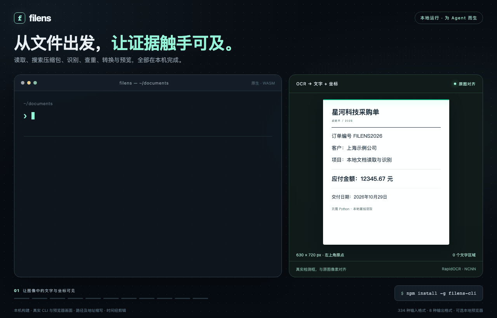
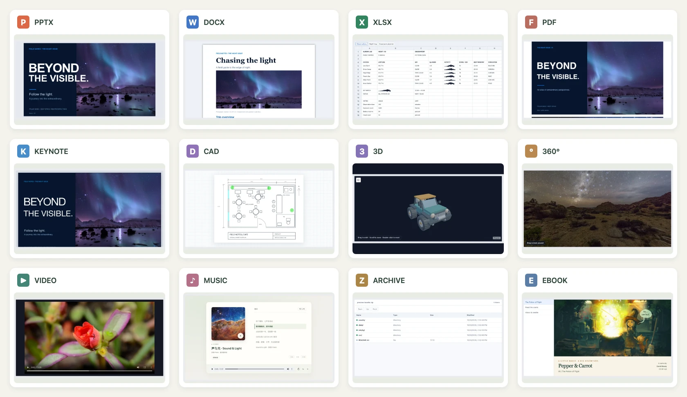
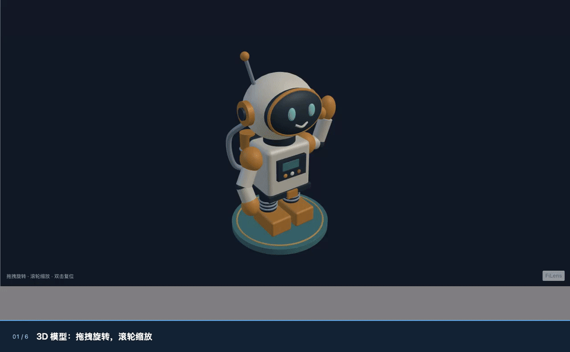
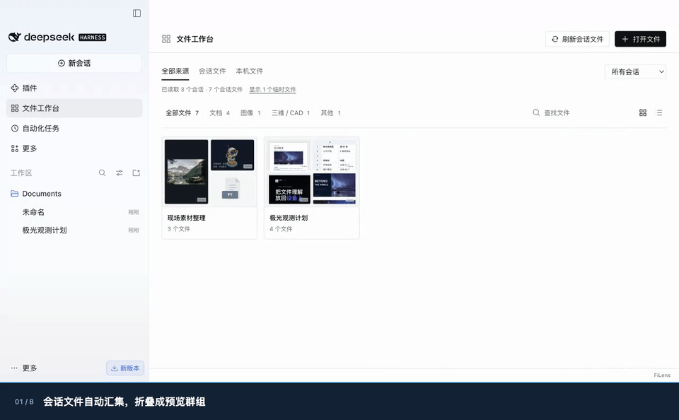

<div align="center">
  
  <h1>探微 · filens</h1>
  <p><strong>给 Agent 的 CLI，也是一套纯前端复杂格式预览工具。</strong></p>
  <p>本地读取、搜索、OCR、转换与预览，文件无需上传。</p>
  <p><a href="README.md">English</a> · 简体中文 · <a href="LICENSE">MIT</a></p>
</div>



[](apps/demo/public/home/filens-demo.mp4)

[▶ 观看 30 秒演示](apps/demo/public/home/filens-demo.mp4) · [预览动图](docs/assets/readme/demo.gif) · [完整格式与限制](docs/support-matrix.zh-CN.md)

**最新版本：[v0.6.6](https://github.com/IceWhaleTech/filens/releases/tag/v0.6.6)** · CLI **0.5.6** · 预览 **0.3.6** · 移动端 SDK **0.1.6** · DSH **0.1.8**。

| | Agent CLI | 纯前端预览 |
| --- | --- | --- |
| 用来做什么 | 向 Agent 提供文档原文、搜索结果、OCR 与可定位证据，也可打开浏览器预览。 | 在应用中预览 Office、iWork、PDF、CAD / 3D、RAW、全景、压缩包等大量复杂格式。 |
| 支持格式（按扩展名） | **349 种**。 | **450 种**，含直接预览与本地 WASM 转换后预览。 |
| 大概多大 | **Lite 6.90–7.17 MiB（<10 MB） · Full 31.26–33.80 MiB** 离线下载；Full 含预览资源、OCR 运行时与模型，Lite 的预览资源另行下载。 | **压缩后单个分包几 KB 到几百 KB**，共享依赖、Worker、WASM 另计；也提供 **all-in-one 单 JS 文件**。 |
| 从这里开始 | [安装与使用 CLI](#agent-cli) | [预览与接入](#纯前端预览) |

原生可执行文件为 **0.92–2.20 MiB**。上表 CLI 体积为 **v0.6.6 完整离线压缩包下载量**，Full 内置预览 **0.3.6**、OCR 运行时与模型；Lite 保留读取、搜索和转换，OCR 与预览资源按需补充。Lite 压缩包硬性限制为 **小于 10,000,000 字节（10 MB）**，达到或超过上限就打包失败。完整下载与解压体积见[离线包体积](docs/preview-release-sizes.json)（1 MiB = 1,048,576 字节）。npm CLI 0.5.6 基础组件安装体积仍为 **Lite 8.00–9.27 MiB / Full 31.43–37.06 MiB**，不含 Node.js、缓存和预览资源。前端分包说的是压缩产物。预览 0.3.6 源码构建的主运行时按分包合计 **4.16 MB Brotli**，单 JS 版预压缩产物为 **3.40 MB Brotli / 3.54 MB gzip / 6.69 MB 原始体积**；可选压缩包引擎及 Worker 在两种构建中均另计 **0.36 MB Brotli / 0.46 MB gzip / 1.17 MB 原始体积**。主运行时已包含 Vue、样式、文档 / 图片 / STEP WASM 与相关 Worker。媒体优先使用浏览器原生支持，HEIC/HEIF 使用小型解码器兜底。[CLI 各平台实测](docs/agent-cli-npm-release.json) · [独立预览构建实测](docs/preview-build-sizes.json)。

格式清单已于 2026-11-06 核对：CLI **349** 个扩展名；预览 **450** 个源文件扩展名（内部另有 `cad-json`，共 **451** 个路由项）。[版本、数量与完整扩展名](docs/release-v0.6.6-format-counts.json)。

## Agent CLI

**支持 349 种文件格式（按扩展名统计）**，在本地读取 PDF、Office、表格、扫描件和图片；搜索目录与嵌套压缩包、提取关键原文、查找重复文件与相似图片。输出 text、JSON、Markdown、HTML、YAML、XML、CSV 或 TSV，保留可用的页码坐标与文档结构。具体能力以 `filens capacity --json` 为准，提取保真度因格式而异。改写总结、翻译和问答由调用它的 Agent 完成。

### 安装与使用

**把这句话发给你的 Agent：**

> 帮我安装 filens，去 https://github.com/IceWhaleTech/filens 找 skills/filens/SKILL.md，按里面的说明配置 CLI 和 Skill。

[Skill 使用说明](skills/filens/SKILL.md) · 手动安装可从 [v0.6.6 Release](https://github.com/IceWhaleTech/filens/releases/tag/v0.6.6) 下载对应平台的离线包并完整解压。Full 自带离线预览、OCR 与模型；Lite 的 OCR 与预览资源按需补充。两者运行均无需 Node.js 或 npm。

```sh
filens '读取 "report.pdf"，以 JSON 输出'
filens '在 "./documents" 中搜索 "预算 风险"，以 JSON 输出'
filens summarize report.pdf --query '预算 风险' --json
filens convert report.doc report.docx

filens inspect unknown-file --json
filens capacity --json
```

`filens inspect 文件 --json` 通过有界内容读取识别实际格式，返回 MIME、证据等级及扩展名是否匹配；无法确定时保留未知。无需 OCR，不代表完整文件校验。

### 离线浏览器预览

**CLI 0.5.6：**`filens preview report.pdf` 生成包含原文件、预览引擎和许可说明的独立 HTML，本地打开后即退出，无需服务器，无需上传文件。v0.6.6 Full 包内置预览 0.3.6，解压后即可使用。Lite 需另行下载并解压 [all-in-one 运行时 ZIP](https://github.com/IceWhaleTech/filens/releases/download/v0.6.6/filens-preview-0.3.6-all-in-one.zip)，通过 `--assets /path/to/filens-preview-0.3.6-all-in-one` 或 `FILENS_PREVIEW_DIR` 指定；将运行时内容放入可执行文件旁的 `preview/` 目录也可自动识别。npm CLI 0.5.6 保留预览 0.3.4；DSH 0.1.8 内置预览 0.3.6；npm 安装可运行 `filens setup-preview` 提前准备资源。预览包包含单文件和分包构建，与 CLI 分开计量：[包体积实测](docs/preview-package-sizes.json)。

```sh
# 导出可携带的离线预览，不覆盖已有文件
filens preview report.pdf --output report-preview.html --no-open
# 返回生成文件的 URL 和路径
filens preview report.pdf --no-open --json
# 浏览器兼容模式：回环 HTTP 服务，Ctrl-C 退出
filens preview report.pdf --mode serve
```

页面检测浏览器能力，并禁止外部资源请求。HTML 含原文件副本，临时 HTML 在退出后保留。Safari / WebKit 的 iWork 预览需使用 HTTP 兼容模式。[预览配置与限制](packages/preview/README.md#cli-preview) · [浏览器验证](docs/preview-html-validation.json)。

### ZimaOS

**[ZimaOS ModStore](https://github.com/IceWhaleTech/Mod-Store/tree/main/builtin/filens)：** 运行 `sudo zpkg install filens` 安装；已有版本先执行 `sudo zpkg update`，再执行 `sudo zpkg upgrade filens`。ModStore 0.5.1 为 Linux x64 / arm64 内置离线 HTML 预览引擎，固定关闭自动打开浏览器。将生成的 HTML 下载或复制到电脑后查看，`--json` 返回 ZimaOS 上的文件路径；无需 Node.js 或 npm。[安装、导出预览和 OCR 配置](packaging/zimaos/README.md)。

<details>
<summary>CLI 精确体积、能力与更多示例</summary>

<!-- agent-cli-size:zh:start -->
  <p><strong>CLI 可执行文件 2.20 MiB · Lite 7.17 MiB · Full 31.91 MiB · <a href="LICENSE">MIT</a></strong><br /><sub>v0.6.6 离线下载 · macOS arm64 · CLI 0.5.6；Full 含预览 0.3.6 和 OCR 模型，Lite 另配预览资源；<a href="docs/preview-release-sizes.json">各平台完整数据</a></sub></p>
<!-- agent-cli-size:zh:end -->

- [安装、协议与打包](docs/agent-cli.md) · [Agent skill](skills/filens/SKILL.md)
- [输出格式与布局信息](docs/agent-cli-formats-and-layout.zh-CN.md) · [68 条实测案例与自然语言边界](docs/agent-cli-examples.zh-CN.md)
- [跨格式搜索](docs/agent-cli-search.zh-CN.md)、[嵌套压缩包](docs/agent-cli-search-archives.zh-CN.md)与[无模型关键原文摘录](docs/agent-cli-pruning.zh-CN.md)
- [重复文件与相似图片](docs/agent-cli-similarity.md) · [Windows 安装与验证状态](docs/agent-cli-windows.zh-CN.md)
- [搜索覆盖](docs/agent-cli-search-formats.zh-CN.md)、[检索基准](docs/agent-cli-search-benchmark.zh-CN.md)与[启动成本](docs/agent-cli-search-native.zh-CN.md)

CLI 使用 Rust，转换复用前端核心。Full 内置 RapidOCR NCNN（最大边长 960、OpenMP 线程 2），Lite 可用 `filens setup-ocr` 补齐。用 `capacity` 查看当前安装版本的操作与转换组合。自然语言只识别有限意图；选择页码或幻灯片请显式使用 `--pages` / `--slides`，尚不支持按问题筛选字段。Windows / Linux 原生执行仍待实机验证。

**macOS OCR 对比：**本机图片实测中，Apple Vision 热调用更快，但漏掉极小字，模糊输入也不总是更准；首次启动反而更慢。目前不能全面替代 RapidOCR。[实测、能力差异与复现](docs/macos-ocr-benchmark.zh-CN.md)。

</details>

## 纯前端预览

**支持 450 种文件格式，在浏览器本地解析和渲染，无需上传或转换服务器。** 按扩展名统计，包含直接预览与本地 WASM 转换后预览。直接浏览 Keynote 幻灯片、Pages 页面、Numbers 表格，读取 Office 与 PDF，检查 CAD / 3D 模型，查看 RAW 和 360° 照片、视频。各格式的支持范围与限制见[支持矩阵](docs/support-matrix.zh-CN.md)。

### DeepSeek Harness 插件

**对比 DSH 内置预览，典型样例首开提速：PPTX 13.56× · DOCX 16.46× · PDF 1.73×。**

| 典型文件 | DSH 内置 · 首开 | FiLens 0.1.3 · 首开 | 提速 |
| --- | ---: | ---: | ---: |
| PPTX 演示文稿 | 1,830 ms | **135 ms** | **13.56×** |
| DOCX 文档 | 1,827 ms | **111 ms** | **16.46×** |
| PDF 文档 | 329 ms | **190 ms** | **1.73×** |

2026 年 11 月 5 日，Apple M4 Pro / macOS、DSH Desktop 0.2.1-rc.5，每种格式配对测量 9 轮，取读取至渲染就绪的中位数，不含应用启动。Office 与 PDF 分轮测量；这里保留 FiLens 0.1.3 的实测结果。PDF 重复打开也从 **110 ms 降至 77 ms（1.43×）**。[Office 原始样本与方法](docs/assets/dsh-plugin/performance-retest.zh-CN.md) · [PDF 原始样本与方法](docs/assets/dsh-plugin/pdf-reopen-optimization.zh-CN.md)。

在「插件 → 添加插件」中填写 [`dsh-filens@0.1.8`](https://www.npmjs.com/package/dsh-filens)，点击「安装 → 立即启用」，即可原生预览 **450 种格式**，并使用本地读取、OCR、搜索和转换。[安装与使用](integrations/deepseek-harness/README.zh-CN.md) · [3D / 全景演示](docs/assets/dsh-plugin/README.md#3d-and-360-gallery) · [性能实测](#性能与文档)。

<!-- dsh-package-metrics:start -->
**DSH 0.1.8：下载 5.81 MiB / 解包 17.58 MiB**，包含工作台；独立工作台包 **0.03 MiB**。CLI/OCR 依赖与 DSH 缓存另计。[包体积与正式包记录](docs/dsh-plugin-package.json)。
<!-- dsh-package-metrics:end -->

**0.1.7 演示：** 在真实 DSH Desktop 中使用中文界面与中文字幕分别录制，使用正式升版前的本地工作台候选构建。[发布说明、录制来源与素材](docs/releases/dsh-filens-0.1.8/README.md) · [旧版公开包安装演示](docs/assets/dsh-plugin/README.md)。


在同一侧栏中旋转、缩放 3D 模型，环视 360° 照片并播放全景视频。[全彩动画 WebP](docs/assets/dsh-release/3d-and-panorama.zh-CN.webp) · [完整 MP4](docs/assets/dsh-release/3d-and-panorama.zh-CN.mp4)。



0.1.8 新增独立的「文件工作台」（`dsh-filens-workspace@0.1.1`）：按会话收拢文件，显示真实缩略图和相关文件，并能返回文件所在的消息或对应提问；开关独立于侧栏预览。



### 浏览器集成：单文件与按需分包

**预览 0.3.6：** 分包 ZIP **5.62 MiB**，单 JS 版 ZIP **10.61 MiB**。从 [v0.6.6 Release](https://github.com/IceWhaleTech/filens/releases/tag/v0.6.6) 下载浏览器预览 ZIP。分包版部署整个解压目录；单 JS 版同样保留压缩包引擎配套资源，按需启用 RAR / 7z。

npm：[filens-preview@0.3.6](https://www.npmjs.com/package/filens-preview/v/0.3.6)，下载 **16.22 MiB** / 安装 **31.88 MiB**，包含两种构建。[公开注册表验证](docs/preview-npm-registry-validation.json)。

两种构建使用同一 API，均包含 Vue、样式和转换引擎，宿主应用不需要安装 Vue。

```html
<div id="preview" style="height: 80vh"></div>
<script type="module">
  // 部署整个解压目录；分包版引擎按需加载。
  import { createPreview } from './filens.js';
  // 单 JS 版入口相同，已内嵌样式、WASM 与 Worker。
  // 保留压缩包配套资源以启用 RAR / 7z。

  const viewer = createPreview('#preview', { src: './report.pdf', name: 'report.pdf' });
  // viewer.update({ src: anotherFile, name: anotherFile.name });
  // viewer.destroy();
</script>
```

部署解压后的运行时目录，通过 HTTP(S) 导入 `filens.js`。Vue 应用也可直接使用统一的 [`Preview` 组件](packages/vue/README.md)；独立 JS 接入与 CLI 预览见[接入指南](packages/preview/README.md)。单文件版部署简单、首次下载更大，格式能力与分包版一致。

### iOS / Android SDK

**SDK 0.1.6 / 预览 0.3.6：** iOS ZIP **5.64 MiB**，Android ZIP **5.65 MiB**。
提供 Swift Package 与 Android Library 源码 SDK，封装同一份
前端与 WASM，支持离线文件预览、渲染 / 错误回调和资源释放。[构建与接入](sdk/README.zh-CN.md) · [运行时与 SDK 体积](docs/preview-sizes.md)。

### 格式覆盖

| 文件 | 可以怎样预览 | 主要限制 |
| --- | --- | --- |
| PPTX、Keynote / Pages / Numbers | 幻灯片、页面和工作表画布。 | 布局、字体和对象保真度随文件变化。 |
| DOCX、XLSX / CSV、PDF | 文档、工作表与分页 PDF。 | 只读，复杂样式可能不同。 |
| DOC / XLS / PPT、WPS / ET / DPS | 本地 WASM 转换后预览。 | 面向预览，移除宏。 |
| PSD / PSB、AI / EPS / PS | 预览保存的合成图或矢量 PDF。 | PSD/PSB 限 8 位 RGB / 灰度；PostScript 为有界预览子集，[详见限制](docs/design-preview.md)。 |
| DXF、STEP / STP、网格模型 | 平移图纸、旋转与缩放三维几何。 | STEP 不保留源颜色、名称和装配树。 |
| RAW、常见图片和图标 | 优先读取内嵌 JPEG，否则轻量显影。 | 相机覆盖和成像质量有差异。 |
| 360° 照片与视频 | 交互查看及部分相机原片拼接。 | 原片拼接为实验性，依赖标定、伴随文件与浏览器编解码器。 |
| 压缩包、电子书、代码、思维导图和流程图 | 浏览条目、章节、源码与节点关系。 | 各格式支持范围见格式矩阵。 |

### 包体积与加载成本

<details>
<summary>展开查看分包精确体积与加载成本</summary>

<!-- bundle-sizes:zh:start -->
| 分包 / 核心 | 原始 | gzip | Brotli |
| --- | ---: | ---: | ---: |
| 转换核心 WASM（Office 加密检测） | 927.9 KiB | 414.3 KiB | **334.3 KiB** |
| 图像 / RAW 核心 WASM | 2915.6 KiB | 940.3 KiB | **713.2 KiB** |
| 媒体 / 全景预览 | 465.1 KiB | 128.8 KiB | **108.3 KiB** |
| STEP truck WASM | 925.5 KiB | 326.4 KiB | **255.0 KiB** |

文档、图像 / RAW 与 STEP 的 WASM 模块独立按需加载。媒体预览模块与图像转换核心分别计量。JS 分包已包含对应 CSS，共享依赖和 Worker 单列。

<details>
<summary>展开查看全部分包及首屏成本</summary>

| 分包 / 核心 | 原始 | gzip | Brotli |
| --- | ---: | ---: | ---: |
| Office 解密 WASM（可选） | 370.6 KiB | 160.3 KiB | **127.4 KiB** |
| DWG 读取 WASM（按需） | 886.8 KiB | 432.4 KiB | **351.8 KiB** |
| 光栅图像预览 WASM（按需） | 1747.7 KiB | 717.4 KiB | **537.7 KiB** |
| PostScript WASM（可选） | 2429.4 KiB | 745.6 KiB | **516.0 KiB** |
| HEIC / HEIF 解码 WASM | 1423.8 KiB | 470.2 KiB | **344.5 KiB** |
| 演示站入口 | 241.8 KiB | 69.5 KiB | **58.1 KiB** |
| Agent CLI 演示界面 | 34.9 KiB | 13.5 KiB | **11.1 KiB** |
| 共享第三方依赖 | 813.1 KiB | 229.7 KiB | **192.1 KiB** |
| PPTX / 核心运行时 | 385.3 KiB | 108.2 KiB | **91.8 KiB** |
| Vue 预览容器 | 247.2 KiB | 66.0 KiB | **52.5 KiB** |
| DOCX / XLSX / PDF | 51.7 KiB | 16.0 KiB | **14.4 KiB** |
| DOCX 按需引擎 | 74.6 KiB | 20.1 KiB | **18.1 KiB** |
| Office 附件 | 31.4 KiB | 12.1 KiB | **11.0 KiB** |
| 共享 XML 兼容层 | 27.2 KiB | 8.9 KiB | **8.0 KiB** |
| 共享 ZIP 兼容层 | 41.5 KiB | 12.7 KiB | **11.6 KiB** |
| 加密 ZIP 支持 | 99.1 KiB | 37.0 KiB | **32.3 KiB** |
| PDF 按需引擎 | 435.2 KiB | 128.1 KiB | **106.9 KiB** |
| iWork 预览 | 40.5 KiB | 12.1 KiB | **10.8 KiB** |
| CAD / 思维导图 / 流程图 | 100.6 KiB | 28.4 KiB | **24.4 KiB** |
| 3D 预览 | 109.0 KiB | 31.7 KiB | **27.7 KiB** |
| glTF / GLB 模型加载器 | 42.7 KiB | 12.6 KiB | **11.2 KiB** |
| FBX 模型加载器 | 43.9 KiB | 14.1 KiB | **12.6 KiB** |
| OBJ 模型加载器 | 8.5 KiB | 2.9 KiB | **2.6 KiB** |
| MTL 模型加载器 | 4.2 KiB | 1.7 KiB | **1.5 KiB** |
| 3DS 模型加载器 | 8.4 KiB | 2.8 KiB | **2.5 KiB** |
| LDraw 模型加载器 | 24.0 KiB | 8.3 KiB | **7.3 KiB** |
| USDZ 模型加载器 | 8.5 KiB | 2.6 KiB | **2.4 KiB** |
| VRML 模型加载器 | 178.0 KiB | 46.4 KiB | **39.8 KiB** |
| 媒体解码加载器 | 143.1 KiB | 52.5 KiB | **45.5 KiB** |
| 压缩包预览 | 48.1 KiB | 14.6 KiB | **13.1 KiB** |
| RAR / 7z 解压 WASM（可选） | 1089.9 KiB | 429.8 KiB | **332.3 KiB** |
| 压缩包 Worker（可选） | 51.5 KiB | 18.2 KiB | **16.3 KiB** |
| 文本 / 电子书 | 18.1 KiB | 6.9 KiB | **6.1 KiB** |
| iWork Worker | 884.9 KiB | 183.4 KiB | **153.3 KiB** |
| PDF Worker | 1053.3 KiB | 291.1 KiB | **233.1 KiB** |
| STEP truck 加载器 | 2.8 KiB | 1.4 KiB | **1.2 KiB** |

本次构建的入口、预加载 JS 与 CSS 合计 **461.8 KiB Brotli**（原始 1946.8 KiB / gzip 548.9 KiB），另计图片、视频和示例文件。模块会共享依赖；上述体积不代表每种格式的独立总下载量。

</details>

数据来自实际演示站构建。压缩列是产物体积，实际传输取决于托管配置。[完整报告与复现方式](docs/bundle-sizes.md)。
<!-- bundle-sizes:zh:end -->

[格式包体积审计](docs/format-package-sizes.md) 记录了依赖去重、Worker 资源输出，以及组合使用 npm 格式包时的实测收益。

[DWG 优化实测](docs/dwg-preview-optimization.md) 记录了精简 CAD 读取器（443 KB gzip）、直接加载图纸模型，以及 13 份图纸的性能；该读取器已计入上面的构建实测。

上表为 v0.6.6 演示站正式构建实测；新增独立构建的[完整实测](docs/preview-build-sizes.json)另外计量，已包含内嵌依赖。单个分包不代表该格式全部下载成本。

</details>

### 前端项目对比

<details>
<summary>与其他前端项目的能力对比</summary>

| 前端项目 | iWork | 全景照片 / 视频 | RAW 预览 | 原生 PPTX | CAD / 3D |
| --- | --- | --- | --- | --- | --- |
| **filens** | **✅ 三件套** | **✅** | **◐** | **✅** | **✅** |
| [SheetJS CE](https://docs.sheetjs.com/docs/miscellany/formats/) | ◐ Numbers | — | — | — | — |
| [Photo Sphere Viewer](https://github.com/mistic100/Photo-Sphere-Viewer) | — | ✅ | — | — | — |
| [LibRaw-Wasm](https://github.com/ybouane/LibRaw-Wasm) | — | — | ✅ | — | — |
| [vue-office](https://github.com/501351981/vue-office) | — | — | — | ✅ | — |
| [PPTist](https://github.com/pipipi-pikachu/PPTist) | — | — | — | ✅ | — |
| [Online 3D Viewer](https://github.com/kovacsv/Online3DViewer) | — | — | — | — | ✅ |

<sub>✅ 已提供该路径 · ◐ 部分或有条件支持 · — 未见文档记载内置路径。[格式覆盖与边界](docs/support-matrix.zh-CN.md)。</sub>

**iWork、全景、RAW、Office 与 CAD / 3D，在同一个浏览器本地工作台打开。** 上述项目各有所长，filens 将这些预览能力放在一起。

<details>
<summary>对比注记与支持边界</summary>

- 依据各项目公开文档，比较浏览器本地处理路径，不作项目综合排名。具体支持范围与保真程度因文件而异。
- **iWork / PPTX：** filens 原生预览 Keynote、Pages 和 Numbers。SheetJS 提取 Numbers 表格数据，需应用接入界面。PPTist 将 PPTX 导入为演示模型；vue-office 的 [PPTX 核心未开源](https://github.com/501351981/pptx-preview#关于授权)。
- **全景：** filens 与 Photo Sphere Viewer 均可显示照片和视频。filens 还处理受支持的 X5 INSP 原片、Insta360 / DJI 标定与畸变、原片多轨同步及标定 DNG 拼接。相机原片拼接为实验性能力，依赖元数据、配套文件和浏览器编解码器。PSV 的[通用双鱼眼适配器](https://photo-sphere-viewer.js.org/guide/adapters/dual-fisheye.html)不解析 X5 标定。
- **RAW：** filens 优先提取内嵌 JPEG，再走轻量传感器显影；LibRaw-Wasm 通过 API 提供全尺寸 / 半尺寸解码与显影，需应用接入界面。两者的画质目标不同。
- **CAD / 3D：** filens 提供 DXF、STEP 与网格预览。Online 3D Viewer 专注模型浏览、检查与导出，包括 STEP / IGES / IFC。filens 的 STEP 预览保留几何与实例位置，不输出原始颜色、名称和装配树。

</details>

</details>

## 本地运行演示站

需要 Node.js 20+ 与 [Rust / rustup](https://rustup.rs/)，仓库固定 Rust 编译器和 WASI target。

```sh
npm ci
npm run build:wasm
npm run dev --workspace @filens/demo
```

打开[本地演示站](http://localhost:5173/modules/filens/?lang=zh)（需先本地部署，否则请打开 [Vercel 在线演示](https://filens-six.vercel.app/?lang=zh)），选择样例或拖入文件。部署见 [Vercel 指南](docs/deploy-vercel.md)。

## 在 ZimaOS 上安装

<p align="center"><a href="https://www.zimaspace.com/zh/zimaos?utm_source=github&amp;utm_medium=referral&amp;utm_campaign=filens_zimaos&amp;utm_content=readme_banner_zh"></a></p>

从官方 Mod Store 安装 FiLens，在 ZimaOS 终端或通过 SSH 执行：

```sh
sudo zpkg install filens
```

安装包包含 Linux x64 / arm64 原生 CLI 和共享 WASM 引擎，无需 Node.js。安装后运行 `filens capacity --json` 检查能力，再用 `filens read report.pdf --json` 读取文件。OCR 自动复用 Photos 已安装的 NCNN v7 运行库与 RapidOCR 模型；缺少组件或版本不兼容时，运行 `filens setup-ocr` 安装 FiLens 私有的兼容组件，不改动 Photos。文档读取和转换也可在没有 OCR 时使用。

ZimaOS 上运行 `filens preview report.pdf --output report-preview.html --json`，只导出 HTML，不启动浏览器。将 HTML 下载或复制到电脑后打开；HTTP 兼容模式通过 SSH 转发回环端口访问。

如果提示找不到模块，先执行 `sudo zpkg update` 刷新商店索引，再重试安装。构建、发布及更新方法见 [ZimaOS 打包说明](packaging/zimaos/README.md)。

## 性能与文档

<details>
<summary>展开查看 SOTA 实测对比</summary>

更新于 2026 年 11 月 5 日。**12 个实测场景**覆盖 DSH、XLSX、ZIP、PPTX、RAW 与 STEP；每个场景只列最近一次记录的 FiLens 结果与对应基线，并标明测量日期和阶段。小样例与边际提升保留在完整报告。

**DSH 完整侧栏预览**

| 样例 · 首开 / 缓存中位数（ms） | FiLens 0.1.3 | DSH 内置 | 首开提速 |
| --- | ---: | ---: | ---: |
| PPTX | **135 / 81** | 1830 / 124 | **13.56×** |
| DOCX | **111 / 94** | 1827 / 112 | **16.46×** |
| PDF | **190 / 77** | 329 / 110 | **1.73×** |

表中倍数为首开提速；PDF 缓存打开提速 **1.43×**（110 → 77 ms）。Office 与 PDF 来自各自独立的 9 轮配对实测。

**大数据量解析与专业库对比**

| 大数据量解析场景 | 对照实现 | 对照 / FiLens 中位数（ms） | 提速 |
| --- | --- | ---: | ---: |
| XLSX · 2,000 × 64，128,000 格 | SheetJS CE 0.20.3 | 150.94 / **61.72** | **2.45×** |
| XLSX · 8,000 × 64，512,000 格 | SheetJS CE 0.20.3 | 615.71 / **213.50** | **2.88×** |
| ZIP · 10,000 条目，展开 18.34 MiB | JSZip 3.10.1 | 700.55 / **55.52** | **12.62×** |
| ZIP · 2,500 条目，展开 36.23 MiB | JSZip 3.10.1 | 247.99 / **95.37** | **2.60×** |

预热 2 轮、测量 9 轮，交替执行顺序；逐格核对全部单元格值或逐条目核对完整文本。解析计时不含渲染、模块加载、网络与结果校验；DSH 行包含预览渲染。结论限于所列任务和对照，不代表所有格式的综合排名或相同能力范围。[方法、版本、原始样本与复现](docs/featured-performance.md) · [历史对比](docs/performance-comparison.zh-CN.md)。

**PPTX、RAW 与 STEP：各场景最近一次浏览器对照**

| 场景 | FiLens（ms） | 对照（ms） | 提速 | 测量日期 |
| --- | ---: | --- | ---: | --- |
| PPTX · 11.1 MB、13 页，完整解析 | **28.5** | pptx-preview 1.0.7：56.6 | **1.99×** | 10 月 23–24 日 |
| NEF · Nikon D3S，传感器数据 → 预览画布 | **152.7** | LibRaw-Wasm 1.6.0 半尺寸：326.7 | **2.14×** | 10 月 23–24 日 |
| DNG · Pentax K-r，传感器数据 → 预览画布 | **167.7** | LibRaw-Wasm 1.6.0 快速半尺寸：314.4 | **1.87×** | 10 月 23–24 日 |
| STEP · as1_pe_203 装配体，几何导入 | **61.2** | occt-import-js 0.0.23：195.0 | **3.19×** | 11 月 1 日 |
| STEP · tailturbine，几何导入 | **50.6** | occt-import-js 0.0.23：153.9 | **3.04×** | 11 月 1 日 |

日期均为 2026 年。RAW 样本已去掉嵌入 JPEG，输出分辨率与色调和 LibRaw 有差异；STEP 比较解析、细分与校验后的几何，三角剖分不同，不含场景构建和绘制；PPTX 计完整解析。各行采用该场景最近一次记录，输入、模块与 WASM 已就绪。[浏览器方法、置信区间与原始证据](docs/performance-comparison.zh-CN.md)。

</details>

| 想了解什么 | 从这里开始 |
| --- | --- |
| 独立单文件 / 分包构建、CLI 预览 | [预览接入指南](packages/preview/README.md) |
| Vue 接入 | [Vue 组件](packages/vue/README.md) |
| 格式支持范围 | [格式矩阵](docs/support-matrix.zh-CN.md) |
| 架构与 WASM 边界 | [项目概览](docs/project-overview.zh-CN.md) |
| 前端基准与原始数据 | [性能对比](docs/performance-comparison.zh-CN.md) |
| macOS 原生 OCR 与 RapidOCR | [实测对比](docs/macos-ocr-benchmark.zh-CN.md) |
| CLI 与后端接入 | [Agent CLI](docs/agent-cli.md) · [Go + wazero 薄壳](examples/go-wazero-converter/README.md) |

欢迎用日常文件测试并[提交可复现问题](https://github.com/IceWhaleTech/filens/issues/new/choose)。[路线图](docs/roadmap.md) · [MIT 许可](LICENSE) · [第三方声明](packaging/agent-third-party.md)。

<sub>预览截图来自 filens。照片与演示录像保留原许可，见<a href="docs/assets/readme/SOURCES.md">视觉来源与署名</a>。iWork 研究参考 <a href="https://github.com/dunhamsteve/iwork">dunhamsteve/iwork</a>；CAD 参考 <a href="https://github.com/orcastor/cad2x-converter">orcastor/cad2x-converter</a>。</sub>

## Star 历史

[](https://star-history.com/#IceWhaleTech/filens&Date)
