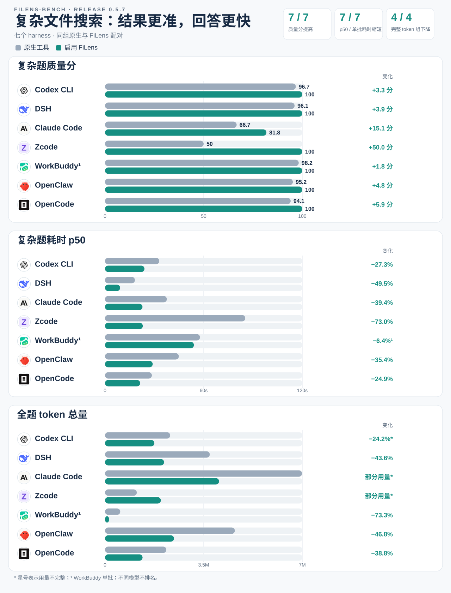

# FiLens-Bench

FiLens-Bench 比较 agent harness 在原生环境和按常规方式安装 FiLens CLI 后，处理复杂本地文件问题的效果。

**独立发布入口：[filens.cc/bench/](https://filens.cc/bench/)** · [English](https://filens.cc/bench/en.html) · [仓库内公开快照](published/converged-2026-11-24/README.md)。评测站单独展示配对成绩、分组柱状图、质量雷达图、方法和限制，并提供 JSON、ZIP 结果包与 SHA-256 校验。公开包不包含原始问题/回答、trace 或逐次账单。

`published/` 是纳入版本管理的公开汇总快照；`results/` 是被 Git 忽略的本地完整运行档案。下文的 `results/` 链接仅供持有本地档案的人查阅，不作为公开下载入口。

## 独立构建与发布

```sh
# 不编译 CLI、WASM 或预览站，只生成评测站和结果包
npm run build:bench
# 可指定其他输出目录，生成的静态目录也能单独托管
node benchmarks/filens-bench/publish.mjs dist/filens-bench-site
```

默认输出为 `apps/demo/dist/bench/`，包含中英文入口、固定版本 `snapshots/converged-2026-11-24/`、JSON、SVG、ZIP 与 `SHA256SUMS`。`build:vercel` 自动附带该目录，部署后通过 `/bench/` 访问；无需额外域名或服务。

更新成绩时，在 `published/converged-YYYY-MM-DD/` 中准备经过核对的 `baselines.json`、`summary.svg`、`quality-radar.svg` 和 `README.md`，更新 `published/latest.json`，运行 `npm run test:bench:filens` 与 `npm run build:bench`。旧公开快照继续随站点发布，固定版本地址保留。构建只读取这四类公开文件，不读取本地 `results/`。

## 当前收敛成绩



各组质量、带证据成功率、p50 耗时和 token 实测值见[中英文公开成绩表](published/converged-2026-11-24/README.md#当前成绩)。公开快照的分组图、雷达图和机器可读数据也在同一目录；逐题评分、p95 和逐次账单保留在本地完整档案中。

## 如何读成绩

成绩按“搜索能力 × agent harness”组织。每个 harness 内比较相同题目、模型、语料和设置下的 `stock` 与 `filens`，查看安装 FiLens 后的准确度、证据完整度、耗时和 token 变化。FiLens 只通过 harness 默认的安装方式加入；题目不要求 agent 必须调用 FiLens。

当前主表各组记录的 FiLens CLI 均为同一发布版本 `0.5.7`。`v6`、`v8`、`v18` 等是**各 harness 的 Skill/安装适配候选编号**，不是不同的 CLI 发布版。不同 harness 要沿用各自默认的 Skill 安装位置、工具发现方式和调用约定；因此 CLI 版本相同，但适配说明不一定逐字相同。运行记录没有为每个 harness 一致保存 CLI 构建 SHA-256，所以目前能确认的是版本号一致，不能从归档证明二进制字节级完全相同。

当前快照使用同一份 13 题合成种子集：11 道复杂文件题计入主质量分，2 道纯文本题作为控制题。除 WorkBuddy 的单轮 13 题 batch 外，各 CLI harness 每组每题运行三次。DSH 使用 DeepSeek-V4.1-Flash，WorkBuddy 使用 Hy4 flash，其余主表记录使用 GPT-6.1-Sol。因此应先读同一 harness 内的 `stock → FiLens` 差值；跨 harness 的数字不构成严格排名。

当前收敛结果和限制：

- [收敛成绩单](results/2026-11-24/converged-scorecard/README.zh-CN.md)：分数、耗时、token、模型和账单入口。
- [机器可读快照](results/2026-11-24/converged-scorecard/baselines.json)：当前选定版本及来源。
- [优化版本归档](results/2026-11-24/converged-scorecard/optimization-archive.md)：未晋级候选、诊断和优化过程。
- [后续复测计划](results/2026-11-24/converged-scorecard/continuation-plan.zh-CN.md)：Claude、Zcode、WorkBuddy、OpenClaw 的起始基准、失败优先级和逐步晋级规则。
- token 金额暂不计价；缺失用量标记为未知，不按零处理。

## 指标与评分

有答案题质量分：

```text
Quality = 100 × (0.70 × 字段准确率 + 0.30 × 证据 F1)
```

答案字段按 NFKC 和空白归一化后精确匹配；引用必须来自正确文件、覆盖必要证据，并能逐字对应原文（空格和换行差异忽略）。无答案题只有明确 `not_found` 且没有猜测或无关证据才算正确。当前评分器核对文件/压缩包成员和引文，尚不核对页码、幻灯片或单元格坐标。

报告还包含带证据成功率、p50/p95 耗时、token 和逐次账单。耗时从问题提交到最终回答结束；失败、超时和启动错误保留在样本中。只有适配器实际报告的 token 才计入用量，未知值为 `null`。金额不计价。

## 题集范围

当前 **v0.1 合成种子集**用于验证方法，不代表对所有文件和 agent 的通用排名。它涵盖 TXT、DOCX、XLSX、PPTX、文本 PDF、嵌套 ZIP 内 DOCX，以及可选 PNG 和扫描 PDF；题目包括版本冲突、表格取值、跨文件求和、长文尾部、扫描件和无答案拒答。参考答案与证据锚点在生成语料前独立指定。

正式 v1 的建议配额为 240 道复杂文件题，另有 30 道纯文本控制题：Word/Office 40、工作簿 40、PDF 30、图片与扫描 PDF 50、演示文稿 20、压缩包 20、跨文件 20、无答案与不完整证据 20。公开真实文档需要授权和独立标注；按文档/主题家族隔离开发集与留出集。该正式题集尚未完成。

## 运行评测

生成一份新的本地语料：

```sh
npm run bench:filens -- prepare --ocr
```

使用已按常规方式安装 FiLens、并准备好隔离原生与安装环境的 Codex 配置：

```sh
node benchmarks/filens-bench/bench.mjs agent \
  --adapter /absolute/path/to/codex.json \
  --task current-owner --repeats 1 --timeout-ms 120000
```

单题确认后去掉 `--task` 跑完整题集。单独补跑安装组可传 `--condition filens`；随后只有在模型、推理设置、harness 版本、语料 hash 和重复次数匹配时，才能与保存的原生观测合并。

配置示例和适配器：

- [Codex](codex.example.json) · [Claude Code](claude.example.json) · [DSH](dsh.example.json)
- CLI 适配器：[Codex](codex-adapter.mjs)、[Claude Code](claude-adapter.mjs)、[DSH](dsh-adapter.mjs)、[OpenClaw](openclaw-adapter.mjs)、[OpenCode](opencode-adapter.mjs)、[Zcode](zcode-adapter.mjs)

评分和表格：

```sh
node benchmarks/filens-bench/bench.mjs score \
  --input /path/stock-observations.json \
  --input /path/filens-observations.json \
  --repeats 3 --output dist/filens-bench/matrix.json

node benchmarks/filens-bench/bench.mjs table \
  --input dist/filens-bench/matrix.json \
  --output dist/filens-bench/tables
```

每次结果保留原始观测、逐题分数和明细账单。模型调用可能产生实际费用；当前成绩单不按金额计价。更多协议与隔离要求见 [bench.mjs](bench.mjs) 和适配器示例。

## 成绩边界

原生组保留该 agent 原有工具；安装组仅增加正常安装 FiLens 所带来的工具发现信息。两组问题提示相同，不注入 benchmark 专用的 FiLens 教程、命令或答案。索引、FTS、embedding、OCR 等底层方案不单独控制或计分。

当前样本小，重复题来自同一合成种子集；WorkBuddy 为桌面端单批测量，耗时与 token 不能和每题独立会话的 CLI 三轮结果直接合并。跨 harness 还受模型、推理设置和工具调度差异影响。所有已验证结果、候选和原始账单仍保留在结果目录；公开摘要只引用收敛快照。
