# 文件工作台 · DSH 实测

这是已经接入 DSH 的源码构建，尚未发布到 npm。使用紧凑工具栏、中性色和细分隔线，阅读界面的文件列表和信息面板分居两侧。深色界面跟随 DSH 外观设置。入口和标题均为「文件工作台」，开发者信息放在底部角落。

截图直接来自本机安装的 **DSH Desktop 0.2.1-rc.5 / macOS arm64**，在隔离的测试 home 中加载本地构建。没有修改用户的 DSH profile，也没有调用模型。截图中的文档、图片和 GLB 都经过共享 FiLens 预览内核实际解析、渲染，文件名经过重命名，内容字节保留。缩略图是现场渲染的预览，不是预先贴入的图片。

## 文件画廊

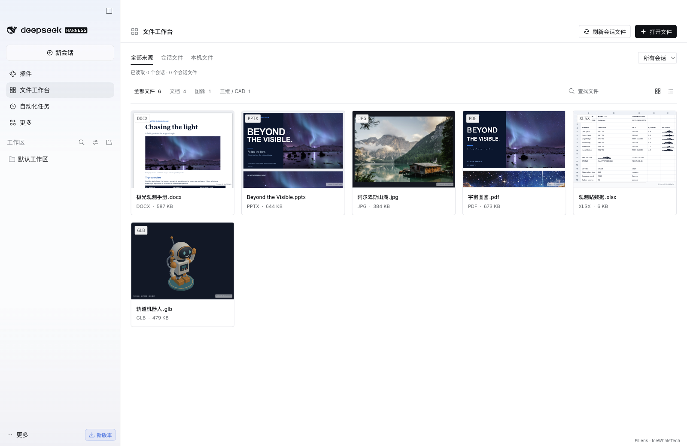

支持会话文件汇集、按会话筛选、本机多文件选择、拖入、分类、搜索和网格／列表切换。

会话文件按来源会话归组，默认折叠成与单文件同列宽的群组卡片，封面以最多四个代表文件组成缩略阵列，Office、PDF 和图像等使用真实预览，没有缩略图时才使用类型封面。会话名读取正式标题，缺失时读取日志中的标题或首条提问；短标题最多显示 12 个字符，完整标题可悬停查看。展开后再读取组内其他可见文件的缩略图，列表模式下群组也使用紧凑横排样式。本机打开的文件单独一组。同一文件可以出现在多个会话组中，点击来源会定位到该组对应的消息。

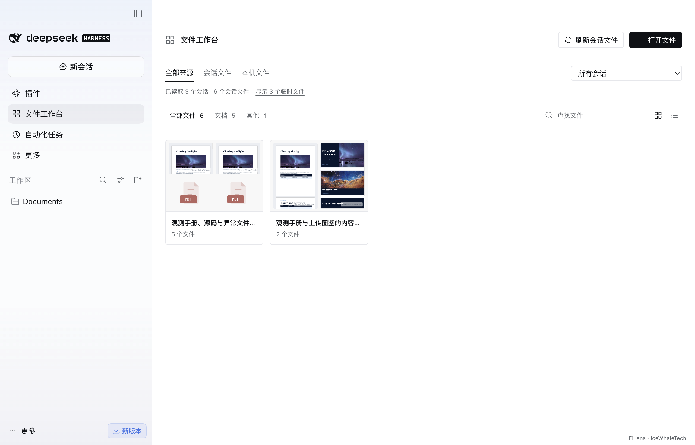

群组封面按文件数量铺排：一个文件占满封面，两个文件并排，三个文件采用一大两小，四个文件使用四格。标题栏只保留短会话名和文件数，减少卡片内部留白。

源码和配置文件使用带折角和格式色标签的文件封面；文件缺失或缩略图生成失败时，也保留封面。该样式沿用仓库演示站的 `FileFormatIcon` 图形，适用于画廊、列表和相关文件。读取错误的详情放在打开后的「查看详情」中。以下为真实 DSH 加载测试文档、源码、缺失文件与损坏 PDF 的截图。

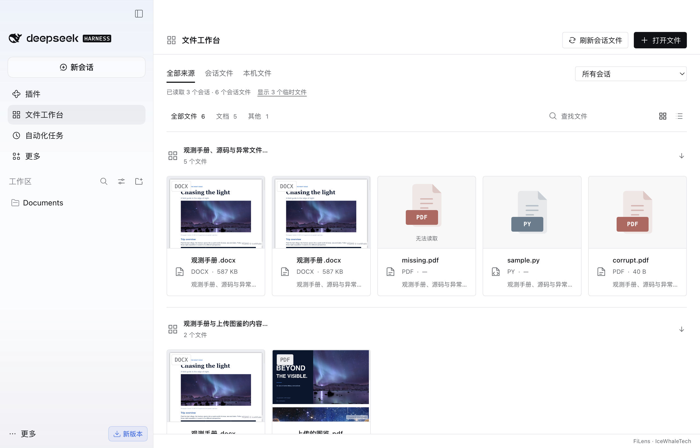

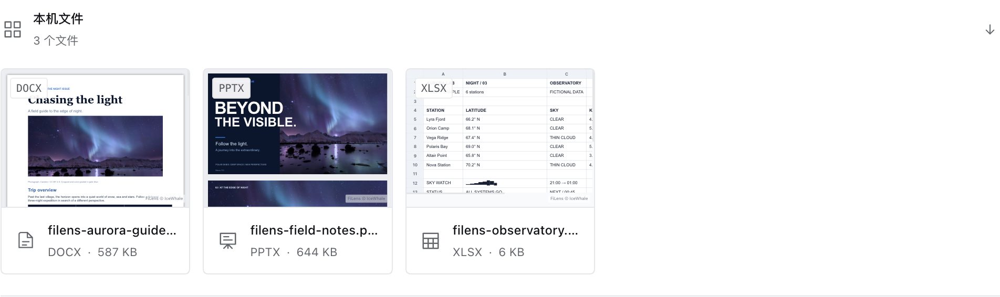

[深色文件封面](file-icons-dark.png) · [列表中的文件封面](file-icons-list.png) · [窄窗口群组卡片](sessions-collapsed-mobile.png)

会话索引保留临时文件引用，默认视图隐藏 Office 的 `~$` 锁文件、macOS 的 `._` 副本、系统杂项、编辑器临时和备份文件，以及 `__MACOSX`、废纸篓中的引用。状态栏可显示或重新隐藏这些文件，隐藏项也不会出现在阅读列表或相关文件推荐中。不会整段排除 `/tmp`、`/var/folders/.../T` 等临时目录，那里正常生成的 PDF、图片和文档仍会显示。本机通过文件选择器明确打开的文件始终保留。

分组、筛选、图标、来源定位和插件启停的桌面验证见 [会话验证记录](session-validation.json)。测试使用合成会话和真实文档字节。

打开文件后，右侧「相关文件」优先展示同一消息、同一提问中出现的文件，其次是同目录和同会话的文件。最多展示 6 项，每项注明关联原因；鼠标点击或键盘 Enter 可直接预览，并保留文件的全部来源消息。推荐排序使用已汇集的引用关系，不调用模型；展示缩略图时才惰性读取可见文件。暂无关联时显示空状态。

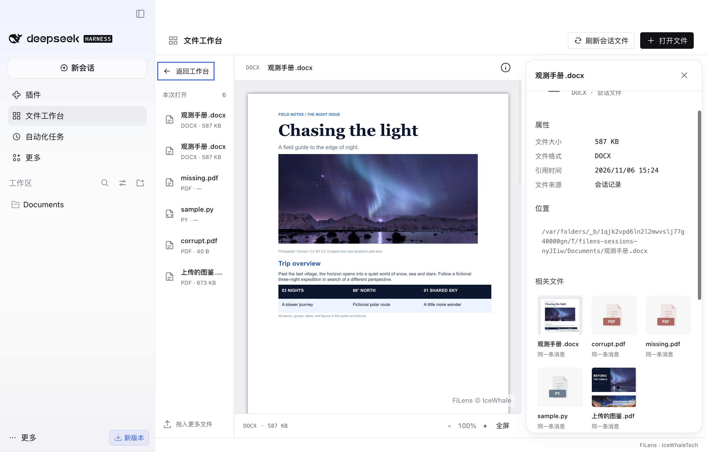

## 文档阅读

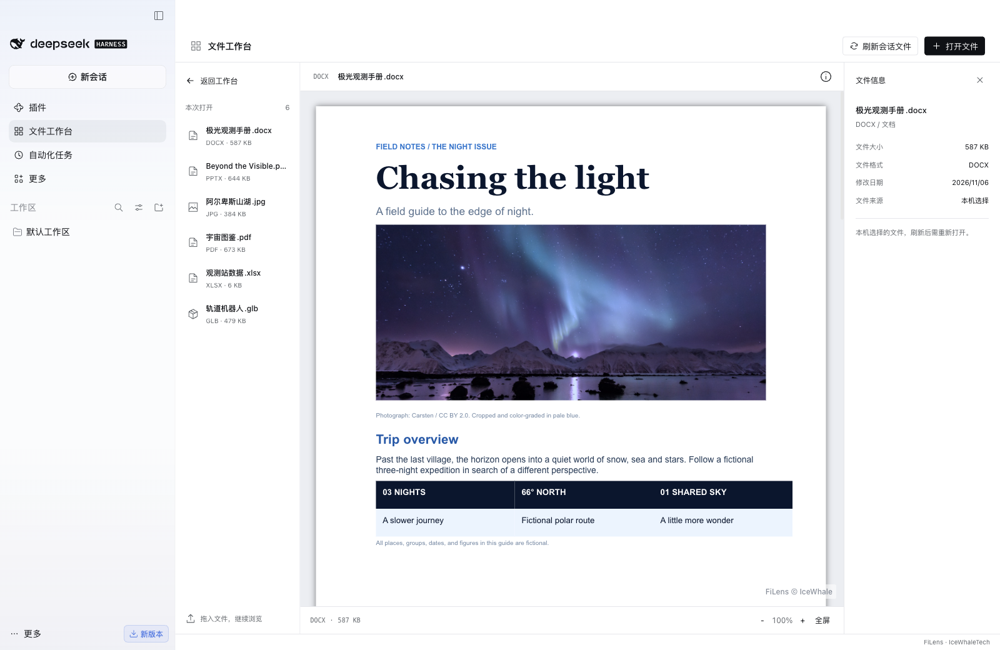

左侧文件列表收窄为 144–160px，用于切换文件，中间复用现有文档预览。缩放与全屏使用共享控件，信息面板可收起。

## 文件详情

信息卡参考本机 ZimaOS Photos 的 `PreviewInfoPanel`：文件名固定在标题栏，正文独立滚动；属性、位置、相关文件和来源消息分区排列。相关文件使用三列真实缩略图或文件封面，保留关联原因和切换预览操作。面板跟随 DSH 深浅色主题，窄窗口下改为底部卡片。关闭按钮和 Escape 都会收起信息卡并恢复信息按钮的焦点，不会重新读取文档。

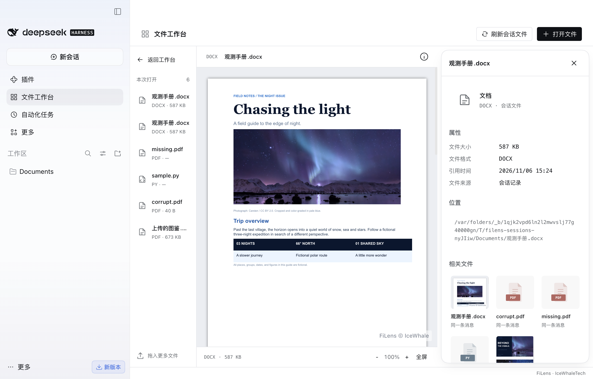

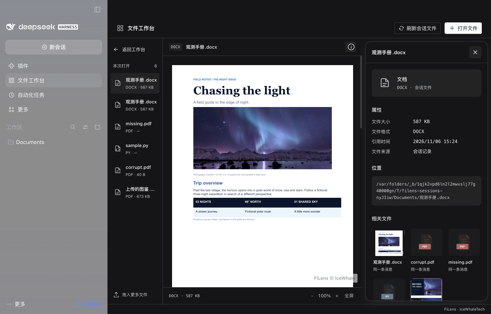

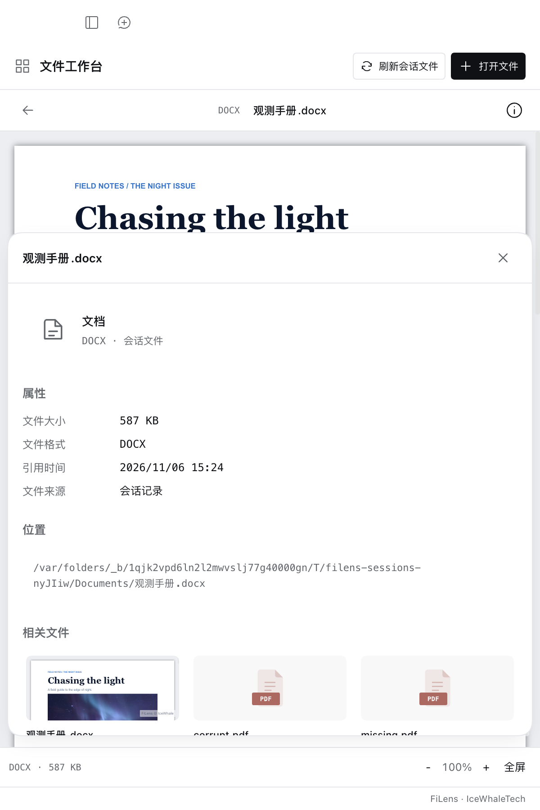

文件大小来自实际读取的字节数，未读取时明确标注；会话文件显示引用时间，本机选择的文件显示浏览器提供的修改时间。此版只整理已有文件信息，没有新增 EXIF、相机或 GPS 信息解析。

## 三维预览

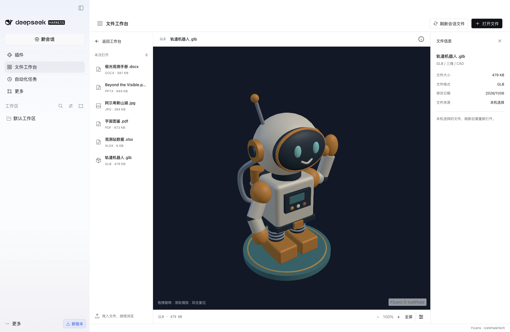

GLB 使用真实 WebGL 画布。验证脚本拖动模型，并比较拖动前后的画布像素。

## 深色界面

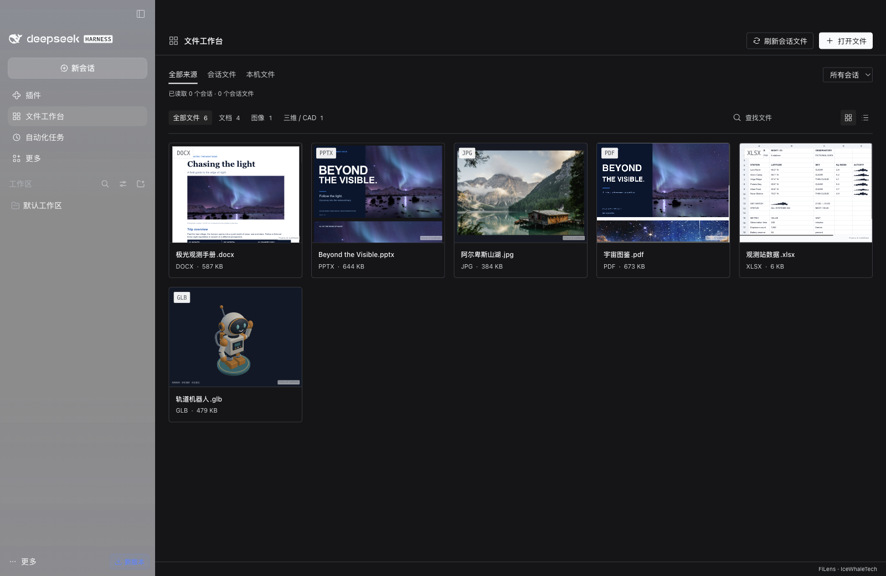

## 其他实测截图

- [首次打开的空状态](01-empty.png)
- [PDF 预览](04-pdf.png)
- [图片预览](06-image.png)
- [PPTX 预览](07-presentation.png)
- [原始验证记录](validation.json)

## 复现

需要本机安装 DSH Desktop、Playwright 及插件构建依赖。脚本自动创建隔离配置，从仓库加载本地插件，启用工作台和侧栏预览。测试不叠加录制光标。

```sh
npm --prefix integrations/deepseek-harness ci
npm --prefix integrations/deepseek-harness run build
npm --prefix integrations/deepseek-harness run test:workspace
npm --prefix integrations/deepseek-harness run test:workspace-sessions
```

可通过 `DSH_DESKTOP_EXECUTABLE` 指定应用路径。验证报告记录实际环境、样例字节数、检查项和截图列表；截图是应用内容区截图，不包含操作系统窗口边框。

## 当前范围

工作台作为第三个插件独立启停，与侧栏预览共用内核、分别管理运行资源。首次进入时逐页扫描会话历史，可点「刷新会话文件」重新汇集。支持格式的本地路径和附件会保留所有来源，文件信息中可以查看所在消息和对应提问。这是引用索引，已删除或无权读取的文件不能预览；本机手选文件刷新应用后需重新选择。

会话测试使用真实 DSH、270 轮和 1 轮的合成历史、真实 DOCX/PDF 文件，检查跨页汇集、跨会话去重、同名不同路径、上传附件预览、旧消息精确定位、从轨迹切换回对话定位提问、独立开关和 `100%` 实际文字边界。详情面板检查真实字节数、固定标题、正文滚动、Escape 关闭与焦点恢复、关闭后预览请求不变、深浅色主题和窄窗口位置。报告输出到 `integrations/deepseek-harness/artifacts/workspace-desktop/validation.json`。工作台只验证了上述 macOS 桌面版本。

样例沿用仓库内的 Office、PDF、图片与自制 GLB。照片、文档素材的署名与许可见[样例来源](../../../apps/demo/public/samples/SOURCES.md)和[共享演示素材说明](../../../apps/demo/public/home/SOURCES.md)。接入方式参考 [dsh-media-desk](https://github.com/woniuniuniu/dsh-media-desk/blob/main/client/index.jsx) 的 DSH 全局面板注册，界面实现位于 [workspace.js](../../../integrations/deepseek-harness/src/workspace.js) 与 [workspace.css](../../../integrations/deepseek-harness/src/workspace.css)。
