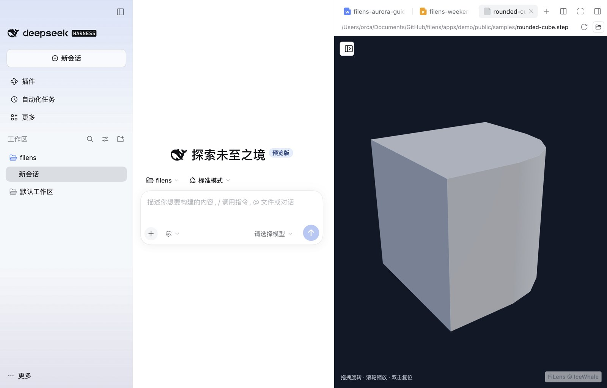

# filens 接入 DeepSeek Harness：可行性与发布准备

调研与实现日期：2026-11-03。依据官方文档、公开源码、npm 元数据与本地集成实测。实现见 [integrations/deepseek-harness](../integrations/deepseek-harness/README.zh-CN.md)，npm 包为 [dsh-filens@0.1.0](https://www.npmjs.com/package/dsh-filens)，对应 [v0.6.2 Release](https://github.com/orca-zhang/filens/releases/tag/v0.6.2)。

## 结论与贡献渠道

可以把 filens 发布为 DSH 的社区插件。官方明确鼓励开发插件并给 GitHub 仓库添加 `dsh-plugin` topic；官方主仓库目前暂不接受外部 PR。现阶段适合通过自己的仓库和可安装包贡献生态。

官方文档提供 npm、Git 和 tarball 安装方式。可安装并自动启用的包需要声明 `dsh.bundle`，由 patch 文件挂载插件。只有普通 npm 包、没有 bundle 声明时，安装不会自动激活插件。

目前没有官方索引源；实验性的「自定义插件索引」功能允许用户添加第三方 JSON 索引。索引收录是额外的分发渠道，不是插件发布的前置条件。在查阅的官方贡献、打包与索引文档中，未见统一的入驻申请表、审核材料清单或强制截图要求。

### 产品主页与分成信息的核验范围

补查了 [DeepSeek Harness 官方产品主页](https://www.deepseek.com/harness/)及英文页。主页介绍桌面端、创造模式、任务成果预览和插件生态，其「社区插件」入口指向 GitHub 的 `dsh-plugin` topic。当前读取到的页面没有给出开发者分成比例、结算规则或申请入口。

用户提到已有开发者拿到分成，该具体案例的插件名称、来源与合作条件尚待核实。上述技术发布流程不能用于推断是否存在商业分成、定向合作或其他激励；本文的材料清单仅覆盖社区插件发布准备，不代表商业合作申请要求。

## 直接执行的路线

已在本地实现 `dsh-filens` 组合包，包含可分别启用的 Host 工具插件和 Client 预览插件。两部分均纳入首版，复用现有 CLI 和 `filens-preview`；实际支持范围以 DSH 集成实测为准。

| 部分 | 用户获得的能力 | 接入位置 |
| --- | --- | --- |
| CLI 工具插件 | Agent 读取文档、OCR、搜索和转换，获得结构化原文与证据。 | `ctx.tools`；通过 DSH 的执行能力薄封装现有 CLI。 |
| Preview 插件 | 点击文件后，在 DSH 右侧预览面板内查看内容。 | `ctx.documentPreviews` 与 `sidebar.right.tab.document`，正文调用 `createPreview()`。 |

先完成一次可安装的端到端演示，再携带包链接、仓库、README 和短视频向官方 Discussions 介绍项目。可以同时询问生态合作、推荐或内置集成，以及是否有适用的激励或分成计划。准备好的提案见 [DSH 插件提案草稿](dsh-plugin-proposal.zh-CN.md)。

## 首版功能与接入依据

官方 `dsh-tool-fs` 文档说明，内置 `read` 只处理 UTF-8 文本，图片由 `read_image` 处理，PDF 等仍列在其延期支持范围。filens 的 PDF、Office、扫描件读取与跨格式搜索有明确的补充价值；这不代表 DSH 的其他社区插件或外部工具都不具备这些能力。

| 建议工具名 | 复用的现有能力 | 交付内容 |
| --- | --- | --- |
| `filens_read` | `filens read … --json` | 原文、来源、完整性、截断状态与可用证据。OCR 随安装能力启用。 |
| `filens_search` | `filens search … --query … --json` | 跨格式文件与受支持压缩包的命中及原文证据。 |
| `filens_convert` | `filens convert … --json` | 支持格式对的转换结果、输出路径、警告与保真度限制。 |
| `filens_excerpt` | `filens summarize … --query … --json` | 按问题选取关键原文；不把摘录宣称为模型生成的总结。 |
| `filens_capacity` | `filens capacity --json` | 查询实际格式、转换对和 OCR 健康状态。 |

DSH 已有 PDF、Office、表格等预览，不能将 `read` 工具的文本限制等同于 DSH 整体缺少文档预览。Preview 插件的重点是提供浏览器本地解析路径，以及 iWork、CAD/3D、RAW 等复杂格式的预览能力。

官方文档与源码已确认以下预览扩展接口：

- `ctx.documentPreviews.register({ id, extensions, binaryExtensions, priority, title, loading })` 注册按后缀匹配的渲染器；第三方 `extension` 档优先于内置实现，匹配的备选仍保留在查看器下拉菜单中。
- 在 Session 作用域的 keyed slot `sidebar.right.tab.document` 以相同 `id` 注册正文。使用 `loading: 'bytes-complete'` 时，DSH 经会话文件接口读取字节，再交给渲染器。
- filens 的 `createPreview(element, { src: Uint8Array, name })` 可消费这些字节，不要求宿主使用 Vue。容器组件负责挂载、更新和 `destroy()`。

首轮预览验收可选 PPTX、Pages/Keynote、STEP、RAW 和 ZIP 中的代表样例，覆盖普通文档与复杂格式；具体格式只有通过 DSH 集成验证后才对外承诺。资源打包需要包含运行时与许可说明，并验证 Worker/WASM 加载、刷新、切换文件及 tab 关闭后的释放。RAR/7z 的可选引擎与 Worker 另行部署和计量。

工具插件使用 TypeScript/JavaScript 注册 DSH 工具，薄封装现有 filens CLI。共享文档解析与转换继续复用前端 WASM 核心，遵守本仓库的转换架构边界。文件访问、子进程和取消应接入 DSH 对应能力接口，明确支持的本地或远程执行环境。

## 需要准备的内容

| 内容 | 具体准备 | 性质 |
| --- | --- | --- |
| 可安装组合包 | `package.json`、`dsh.bundle.patch`、`cordis.patch.yml`、插件入口与构建产物；发布白名单包含运行资源。 | 自动挂载所需。 |
| 工具接口 | `ctx.tools` 注册，参数 schema、结构化结果 schema、模型可读渲染；处理取消、超时与资源清理。 | 工具实现所需。 |
| 兼容性声明 | 实测 DSH 版本、`engines.dsh` 范围；共享宿主实例的 DSH 包放在 peer 与 dev 依赖中。 | 发布前需落实。 |
| filens 依赖方案 | 确定随包依赖 CLI，还是要求已有可执行文件；说明平台、OCR 模型、首次下载与离线条件。 | 发布前需落实。 |
| 使用文档 | 建议提供中英文 README，包含安装、启用、配置、示例、输出含义、限制和排错。 | 建议交付。 |
| 展示信息 | 名称、描述、作者、仓库、主页、许可证；可选 `locale/en.json`、`locale/zh.json` 和图标，配置好资源导出与发布文件。 | 展示增强。 |
| 许可文件 | filens 的 MIT 许可及随包分发的 WASM、OCR 等第三方许可说明。 | 按实际分发内容保留。 |
| 验证记录 | 文本 PDF、扫描 PDF、DOCX、XLSX、中文路径；缺失文件、不支持格式、OCR 缺失、权限拒绝、取消、超时、部分结果与截断。 | 建议作为发布证据。 |
| 演示素材 | 一张真实工具结果截图或短 GIF，配两三个可复现提问和可公开分发的样例。 | 推荐宣传材料，未见官方强制要求。 |

包内展示图标支持自包含的 SVG、PNG、JPEG、WebP，最大 256 KiB；若同时用于索引内联图标，需满足索引的 32 KiB 上限。用小于 32 KiB 的 SVG 可简化两处复用。

本地解析描述需要区分：filens 无需把文件发送给转换服务，但返回给 DSH 模型的文档文本仍受 DSH 的模型与部署配置影响。README 应准确说明数据流。

## 最小发布形态

建议包名示意为 `dsh-filens`，实际名称需在发布时检查可用性：

```text
dsh-filens/
├── package.json
├── cordis.patch.yml
├── lib/preview-host.js
├── lib/tools.js
├── lib/client.js
├── lib/runtime/            # preview runtime, WASM, Worker and notices
├── lib/runtime-manifest.js
├── lib/support.json
├── locale/en.json
├── locale/zh.json
├── icon.svg
├── README.md
├── README.zh-CN.md
└── LICENSE
```

Client 工厂注册、浏览器入口和资源导出遵循实测 DSH 版本的契约。可从 npm 安装组合包：

```sh
dsh plugin --profile web add dsh-filens
```

推荐先交付预构建的 npm 包或 tarball。Git 源码安装的 TypeScript 包需要自包含的 `prepare` 构建，且 pnpm 的构建授权可能增加安装步骤。

若希望进入 Discover，可申请第三方索引收录，或自己用官方参考生成器生成并托管 JSON 索引；用户仍需自行添加索引源。GitHub topic 有助于发现，不等同于官方收录或审核。

## 实现与验证状态

调研时 npm 的 `@deepseek-ai/dsh`：`latest` / `next` 为 `0.2.1-rc.5`，`alpha` 为 `0.2.2-alpha.3`；下载的官方 `master` 源码版本为 `0.2.2-alpha.3`。本地适配锁定 `filens-cli@0.5.2`、`filens-preview@0.3.2`。

已实现 `dsh-filens@0.1.0` 组合包、五个工具、侧栏预览、397 个共享清单后缀、独立启停、配置、本地打包及中英文文档。Host 仅封装既有 CLI 与静态预览资源，文件字节由 DSH 自己的 Session 文件接口加载。

已在用户安装的 macOS arm64 桌面版 `0.2.1-rc.5` 的隔离测试 home 完成安装与真实侧栏 DOCX、Keynote、STEP、ZIP 预览，保留截图。真实 Web profile 的工具管线在 `0.2.1-rc.5`、`0.2.2-alpha.3` 验证读取、OCR、搜索、摘录、转换及独立启停。浏览器适配测试覆盖 12 个代表样例，具体记录见 [VALIDATION.md](../integrations/deepseek-harness/VALIDATION.md)。



权限边界：CLI 默认将执行工作区和 OCR/PDF 中间图片保留在内存中；已在 DSH 严格 `read-only` 下通过查询、读取、OCR、搜索与摘录。转换的最终输出仍需写权限，实际沙箱会拒绝无权限的输出提交。CLI 0.5.2 包含此改造；四个平台均已打包，原生执行验证在 macOS arm64 完成。

没有使用用户账号或发送真实模型提问；工具是通过 DSH 真实执行管线直接调用的。Windows、Linux、远程执行世界、所有注册格式及多分卷归档尚未全面实测。npm 发布、添加 GitHub topic、对外提案与合作咨询均未执行；分成规则仍待官方确认。

## 官方依据

- [官方产品主页](https://www.deepseek.com/harness/)及[英文页](https://www.deepseek.com/en/harness/)：产品能力、创造模式与社区插件入口。
- [贡献说明](https://github.com/deepseek-ai/deepseek-harness/blob/master/CONTRIBUTING.zh.md)：社区插件与暂不接受外部 PR。
- [打包与安装插件](https://github.com/deepseek-ai/deepseek-harness/blob/master/docs/user/develop/basic/publish.zh.md)：bundle、兼容性、依赖与分发方式。
- [构建工具教程](https://github.com/deepseek-ai/deepseek-harness/blob/master/docs/user/develop/basic/tool.zh.md)及[工具编写参考](https://github.com/deepseek-ai/deepseek-harness/blob/master/docs/cookbook/adding-a-tool.zh.md)：工具注册、结果 schema 与取消约定。
- [文件工具说明](https://github.com/deepseek-ai/deepseek-harness/blob/master/packages/fs/tool-fs/README.zh.md)：内置读取能力及其限制。
- [侧栏文档预览](https://github.com/deepseek-ai/deepseek-harness/blob/master/packages/client/ui-sidebar-documentpreview/README.zh.md#what-it-registers)及[渲染器注册表源码](https://github.com/deepseek-ai/deepseek-harness/blob/master/packages/client/ui-sidebar-documentpreview/src/client/document/registry.ts)：第三方文档渲染器与字节加载接口。
- [插件展示元数据](https://github.com/deepseek-ai/deepseek-harness/blob/master/docs/cookbook/adding-a-package.md#plugin-display-metadata)：locale、图标与详情文档。
- [插件索引](https://github.com/deepseek-ai/deepseek-harness/blob/master/docs/user/guide/plugin-market.zh.md)及[实验性索引组合包](https://github.com/deepseek-ai/deepseek-harness/blob/master/packages/experimental/plugin-market-bundle/README.zh.md)：用户添加索引及没有官方索引的现状。
