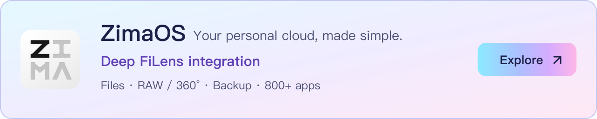

# v0.6.8 — Smaller previews, updated CLI and DSH

CLI **0.5.8** · preview **0.3.8** · iOS/Android source SDKs **0.1.9** · DSH plugin and File workspace **0.1.12** · XLSX **0.1.3** · core **0.1.5**.

Browser/SDK release: **2026-11-24**; CLI/DSH and mobile SDK refresh: **2026-11-25**.

CLI and DSH are rebuilt and updated to use preview **0.3.8**. Full offline CLI downloads are now **24.87–27.48 MiB**, down from **31.26–33.80 MiB**; Lite downloads are **7.09–7.72 MiB**. All eight platform/profile bundles and the DSH plugin are available below.

本次同步更新 CLI、DSH 和内置预览内核，补齐 macOS、Linux、Windows 的 Full/Lite 离线包和 DSH 插件下载。Full 包缩至 **24.87–27.48 MiB**，Lite 为 **7.09–7.72 MiB**；渲染对比统一使用最新复测结果，包括下降的倍数，ZimaOS 展示与安装入口也已恢复。

## Changes

- **Preview 0.3.8:** fixes deferred HEIF resources in offline workers; groups packed resources, shares the compiled decoder, and creates workers/restores WASM when needed. `filens-preview` is **9.76 MiB** packed, down from **16.22 MiB**; split-only `filens-preview-split` is **5.64 MiB**.
- **CLI 0.5.8:** faster directory discovery and glob subtree pruning, bounded document-extraction windows, and better preservation of fine text in transparent-scan OCR. Full bundles embed preview 0.3.8 and omit optional precompressed JS sidecars. Native-search speed optimization increases the macOS executable to **3.74 MiB**, so Lite is slightly larger; every Lite archive remains below **10,000,000 bytes**.
- **DSH 0.1.12:** embeds preview 0.3.8, pins CLI 0.5.8 and retains File workspace in the same plugin. Fixes bundled runtime loading through the Desktop application origin in DSH **0.2.3-alpha.2**, with **0.2.2-rc.1** also tested. The peer range includes **Cordis 4.2**; an isolated latest-library installation passes without forced dependency resolution. Plugin download: **5.75 MiB**, excluding CLI/OCR dependencies and DSH caches.
- **TypeScript declarations:** publishes `@filens/xlsx@0.1.3` and `@filens/core@0.1.5` with explicit ESM relative paths for Node16/NodeNext. XLSX requires core `^0.1.5`; exported types remain available and the driver factory retains its function type. [Fix #34](https://github.com/orca-zhang/filens/pull/34).
- **Mobile source SDKs 0.1.9:** each complete offline ZIP is below **3 MiB** (iOS **2.969 MiB**, Android **2.973 MiB**, down from 5.66 MiB). All offline formats are retained. Run bundled `node prepare-runtime.mjs` once on the developer computer before integration; requires **Node.js 18+ and a C++17 compiler**. The app uses streamed Brotli assets, lazy workers/modules and a compact complete WASM core. Strong decompression runs only on the developer computer. Native startup checks, stream handling and missing-decoder fallback are hardened. Full required notices remain compressed. These are source projects, not precompiled AAR/XCFramework binaries; ZIP size is distinct from installed app size.

移动端 SDK 已更新为 **0.1.9**：两个平台各一个完整离线 ZIP，均小于 **3 MiB**。接入前在开发机执行一次包内的 `node prepare-runtime.mjs`（需要 Node.js 18+ 和 C++17 编译器）；手机端保持流式读取，保留全部离线格式与完整压缩许可正文。

## Downloads

| Artifact | Download size |
| --- | ---: |
| [filens-0.5.8-macos-arm64-lite.tar.gz](https://github.com/orca-zhang/filens/releases/download/v0.6.8/filens-0.5.8-macos-arm64-lite.tar.gz) | 7.72 MiB |
| [filens-0.5.8-macos-arm64-full.tar.gz](https://github.com/orca-zhang/filens/releases/download/v0.6.8/filens-0.5.8-macos-arm64-full.tar.gz) | 25.99 MiB |
| [filens-0.5.8-linux-x64-lite.tar.gz](https://github.com/orca-zhang/filens/releases/download/v0.6.8/filens-0.5.8-linux-x64-lite.tar.gz) | 7.24 MiB |
| [filens-0.5.8-linux-x64-full.tar.gz](https://github.com/orca-zhang/filens/releases/download/v0.6.8/filens-0.5.8-linux-x64-full.tar.gz) | 27.23 MiB |
| [filens-0.5.8-linux-arm64-lite.tar.gz](https://github.com/orca-zhang/filens/releases/download/v0.6.8/filens-0.5.8-linux-arm64-lite.tar.gz) | 7.09 MiB |
| [filens-0.5.8-linux-arm64-full.tar.gz](https://github.com/orca-zhang/filens/releases/download/v0.6.8/filens-0.5.8-linux-arm64-full.tar.gz) | 24.87 MiB |
| [filens-0.5.8-windows-x64-lite.zip](https://github.com/orca-zhang/filens/releases/download/v0.6.8/filens-0.5.8-windows-x64-lite.zip) | 7.18 MiB |
| [filens-0.5.8-windows-x64-full.zip](https://github.com/orca-zhang/filens/releases/download/v0.6.8/filens-0.5.8-windows-x64-full.zip) | 27.48 MiB |
| [dsh-filens-0.1.12.tgz](https://github.com/orca-zhang/filens/releases/download/v0.6.8/dsh-filens-0.1.12.tgz) | 5.75 MiB |
| [filens-preview-0.3.8-split.zip](https://github.com/orca-zhang/filens/releases/download/v0.6.8/filens-preview-0.3.8-split.zip) | 5.63 MiB |
| [filens-preview-0.3.8-all-in-one-precompressed.zip](https://github.com/orca-zhang/filens/releases/download/v0.6.8/filens-preview-0.3.8-all-in-one-precompressed.zip) | 6.92 MiB |
| [filens-preview-0.3.8-all-in-one.zip](https://github.com/orca-zhang/filens/releases/download/v0.6.8/filens-preview-0.3.8-all-in-one.zip) | 4.13 MiB |
| [filens-ios-sdk-0.1.9.zip](https://github.com/orca-zhang/filens/releases/download/v0.6.8/filens-ios-sdk-0.1.9.zip) | 2.969 MiB |
| [filens-android-sdk-0.1.9.zip](https://github.com/orca-zhang/filens/releases/download/v0.6.8/filens-android-sdk-0.1.9.zip) | 2.973 MiB |

**16 package downloads + source manifest + checksums (18 assets).** Legacy SDK 0.1.8 assets remain available for existing URLs. [SHA256SUMS](https://github.com/orca-zhang/filens/releases/download/v0.6.8/SHA256SUMS) · [Source and validation manifest](https://github.com/orca-zhang/filens/releases/download/v0.6.8/filens-release-v0.6.8.json) · [Exact sizes](preview-release-sizes.json).

## Install

```sh
npm install -g filens-cli@0.5.8
# Or Lite: npm install -g filens-cli-lite@0.5.8

dsh plugin --profile desktop add dsh-filens@0.1.12

npm install filens-preview@0.3.8
# Split runtime only: npm install filens-preview-split@0.3.8

npm install @filens/xlsx@0.1.3 @filens/core@0.1.5
```

For native installation without Node.js or npm, extract the entire CLI archive. Full includes OCR and offline previews; Lite adds those resources as needed. DSH also accepts the downloadable `dsh-filens-0.1.12.tgz` through its plugin installer. File workspace retains its independent switch.

For mainland China, add `--registry=https://registry.npmmirror.com` when the version is available there. See the [English README](../README.md), [中文 README](../README.zh-CN.md), [preview integration](../packages/preview/README.md) and [DSH setup](../integrations/deepseek-harness/README.md).

## Latest DSH rendering comparison

Measured **2026-11-24**, Apple M4 Pro/macOS, **DSH Desktop 0.2.3-alpha.2 / FiLens 0.1.11**. Nine paired rounds per format, 36 fresh processes and 216 successful opens. Medians include reading, parsing/conversion and rendering to ready plus two frames, excluding app startup; OS/persistent caches remain. Office and PDF use separate runs; DOCX follows PPTX.

| Format · first / cached median (ms) | FiLens 0.1.11 | DSH built in | First-open speedup |
| --- | ---: | ---: | ---: |
| PPTX | **126 / 92** | 1325 / 111 | **10.52×** |
| DOCX | **108 / 92** | 1312 / 112 | **12.15×** |
| PDF | **200 / 108** | 343 / 108 | **1.72×** |

Cached PDF opens are equal at **108 ms (1.00×)**. The released **0.1.12** renderer/workspace payload matches all **73** measured 0.1.11 files byte-for-byte; the follow-up fixes peer declarations and documentation. [Runtime equivalence](dsh-0.1.12-runtime-equivalence.json). Current tables use these results even where the relative speedup is lower than the historical figures. Three authored files on one machine measure latency, not fidelity or performance for every document. [Complete observations, versions and method](assets/dsh-plugin/performance-0.1.11.md).

## Validation

- XLSX/core: **600 unit tests passed**; isolated tarball and fresh public-registry installs pass **12 type checks and 8 original-issue checks** with TypeScript **5.9.3 / 7.0.2**, Bundler/Node16/NodeNext and both skipLibCheck settings. The original invalid assignment reports only the expected TS2322; production Vite/Chromium XLSX rendering also passes.
- CLI: **65 Rust unit tests**, **8 end-to-end groups**, **19 compact-bundle/error/cancellation checks**, **60 search checks** and **54 archive/OCR checks** pass. Full/Lite npm tarball installation and direct native execution pass on macOS arm64.
- The actual new Full offline CLI bundle exports **17 Chromium offline HTML cases** successfully, including Office, PDF, iWork, RAW, STEP, archives and encrypted inputs.
- DSH: **34 Node tests** and six real sidebar formats pass in Desktop **0.2.3-alpha.2** and **0.2.2-rc.1**. Earlier browser checks cover 16 isolated format-loading paths and 12 complete previews; nine-round current Desktop timings are linked above.
- All eight native archives pass integrity/size checks. npm and release artifacts pass license, notice and privacy checks; SHA-256 records exact release bytes. Mobile 0.1.9 adds 34 Chromium/WebKit checks on restored final assets, 44 HEIF pixel checks, 328 conversion fixtures and native streaming/fallback checks. Both final ZIPs restore all 60 assets exactly. Full Gradle AAR / IPA builds and physical-device tests were not run; host preparation was exercised on macOS, with Windows/Linux compiler paths untested.

Linux/Windows executables are cross-built; native execution on those platforms, native Desktop fullscreen and physical iOS/Android devices were not retested. [Validation records](release-v0.6.8-validation.json).

## Use FiLens on ZimaOS

<p align="center"><a href="https://www.zimaspace.com/en/zimaos?utm_source=github&amp;utm_medium=referral&amp;utm_campaign=filens_zimaos&amp;utm_content=release_banner_en"></a></p>

Bring local document previews to your personal cloud. Install FiLens from the official ZimaOS [Mod Store](https://github.com/IceWhaleTech/Mod-Store/tree/main/builtin/filens), without Node.js or npm:

```sh
sudo zpkg update
sudo zpkg install filens
# Upgrade an existing installation:
sudo zpkg upgrade filens
```

[ZimaOS integration, preview export and OCR setup](https://github.com/orca-zhang/filens/tree/main/packaging/zimaos). The ModStore package remains **0.5.1** and uses its own CLI/preview versions; this release does not update the store entry.
