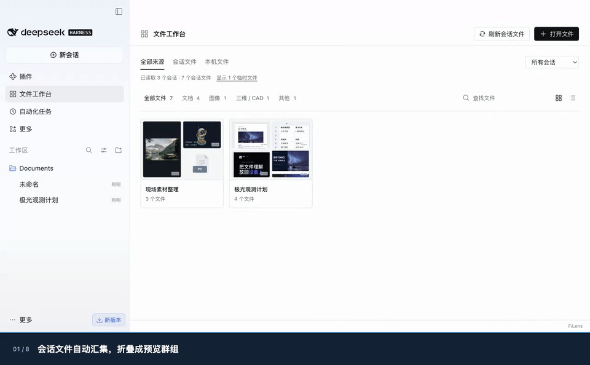

# FiLens for DSH 0.1.7：把会话里的文件放到一起

> 随 [v0.6.6](https://github.com/IceWhaleTech/filens/releases/tag/v0.6.6) 发布；演示保留本地候选构建的原始录制记录。

以前在会话中找到一份文件，需要翻回消息，再从侧栏打开。现在可以进入「文件工作台」，按会话浏览文件、打开预览，并回到文件所在的消息或对应提问。



## 文件工作台

- 从逐页读取的会话历史中收集支持格式的本地路径和附件，合并相同文件并保留各次引用来源。
- 会话默认折叠成预览群组，最多展示四个代表文件；使用简短会话标题，悬停查看完整标题。Word、Excel、PPT 和 PDF 使用真实渲染的缩略图。
- 支持搜索、分类、会话筛选、网格／列表、本机多文件选择与拖入。不能生成缩略图时使用文件类型封面。
- 打开文件后，可查看按消息、提问、目录和会话关系排列的相关文件；点击即可切换预览。
- 详情面板展示属性、位置、相关文件和引用来源，支持跳回原消息或对应提问；窄窗口使用底部信息卡。
- 默认隐藏 Office 锁文件、系统杂项和编辑器临时文件，可手动显示。保留临时目录中正常生成的结果文件。

## 沿用原生侧栏预览

侧栏预览继续支持 Office、PDF、iWork、CAD／3D、RAW 和 360° 媒体。缩放比例和全屏控件保持紧凑，阅读列表宽度为 144–160px。工作台、侧栏预览和文档工具分别启停，使用共享的本地预览内核。

[Office 中文 GIF](../../assets/dsh-release/office-preview.zh-CN.gif) · [3D／全景中文 GIF](../../assets/dsh-release/3d-and-panorama.zh-CN.gif) · [完整素材](README.md)

360° 全景的环视／缩放提示、播放控件、悬浮说明和无障碍标签已接入国际化，随 DSH 语言切换。切换语言不会重新加载视频或重置播放进度。

## 安装（正式发布后）

完全退出桌面应用后执行，安装完成再重新打开：

```sh
dsh plugin --profile desktop add dsh-filens@0.1.7 dsh-filens-workspace@0.1.0
```

## 验证与限制

演示在真实 DSH Desktop 0.2.1-rc.5 / macOS arm64 中分别使用中文和英文界面录制，使用示例会话和真实文档，不调用模型。工作台已有 22 项桌面回归检查；录制另行检查文件打开、工作表切换、全屏翻页、3D／全景交互、缩略图和原提问定位。

工作台索引文件引用，不复制或备份原文件。已删除或不可访问的文件无法保证预览；手选本机文件刷新后需重新选择。临时文件过滤仅影响显示，不删除文件。格式兼容和还原程度仍以[支持矩阵](../../support-matrix.md)为准；本轮未新增跨平台原生测试或性能测试。
