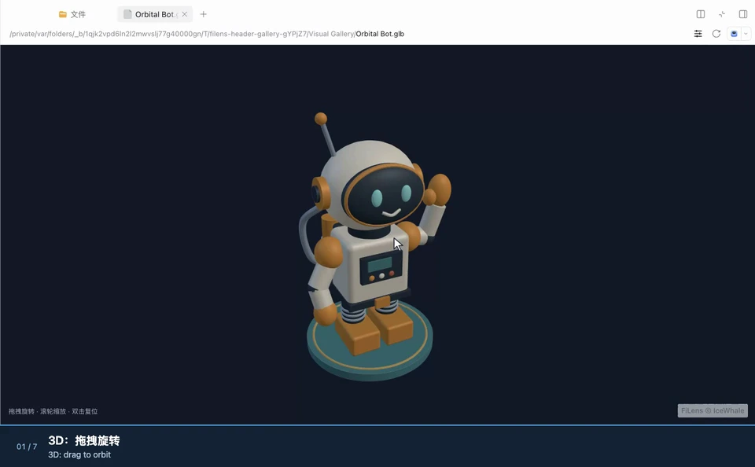

# FiLens for DeepSeek Harness

[English](README.md)

`dsh-filens` 原生接入 DSH 文档侧栏，提供 **450 种格式的本地预览**，并统一安装两个可独立启停的插件：

| 入口 | 功能 |
| --- | --- |
| `filens-tools`（`dsh-filens/tools`） | Agent 本地文档读取、OCR、搜索、原文摘录和转换。 |
| `filens-preview`（`dsh-filens`） | 原生侧栏预览 Office、PDF、iWork、CAD/3D、RAW 和全景媒体，支持 Excel 工作表切换与 PPT 全屏演示。 |

原生侧栏预览直接嵌入 DSH 的现有文件预览区，由 FiLens 在本地解析与渲染，无需另起预览服务。DOCX/PPTX 可直接呈现，无需先经 LibreOffice 转为 PDF；3D 与全景保留旋转、缩放、环视和播放交互。

已发布的 **`dsh-filens@0.1.3` 支持 450 个预览扩展名**。数量按扩展名去重，包含直接预览与本地 WASM 转换后预览；源码构建使用当前共享清单，准确数量以该构建的 `lib/support.json` 为准。格式覆盖与保真度边界见[支持矩阵](../../docs/support-matrix.zh-CN.md)和[验证记录](VALIDATION.md)。

适配层复用 `filens-cli@0.5.6`，从共享前端源码构建 `filens-preview@0.3.4` 运行时，不增加格式解析或转换算法。

实测版本：macOS arm64 上的 DSH **桌面版/Web 0.2.1-rc.5**、**Web 0.2.2-alpha.3**，Node 24。其他 DSH 版本尚未验证。


点击 DSH 工作区文件列表中的 Office 文件，即可使用 FiLens 侧栏预览。Excel 可直接切换工作表；PPT 点击「全屏」后，点击画面，用 **Page Down / Page Up** 演示翻页，**Esc** 返回。DOCX/PPTX 直接渲染，省去 LibreOffice 转 PDF 的步骤。

| 样例 · 首开 / 缓存中位数（ms） | FiLens 0.1.3 | DSH 内置 | 首开提速 |
| --- | ---: | ---: | ---: |
| PPTX | **135 / 81** | 1830 / 124 | **13.56×** |
| DOCX | **111 / 94** | 1827 / 112 | **16.46×** |
| PDF | **190 / 77** | 329 / 110 | **1.73×** |

同机 9 轮配对实测；提速倍数 = 同轮内置中位数 ÷ FiLens 中位数，表中倍数仅指**首开**。首开为进程内该文件首次打开，保留系统与持久缓存；内置 Office 转 PDF，FiLens 直接渲染。[范围与方法](../../docs/assets/dsh-plugin/performance-retest.zh-CN.md) · [MP4](../../docs/assets/dsh-plugin/install-and-preview.mp4) · [GIF](../../docs/assets/dsh-plugin/install-and-preview.gif)。

PDF 使用首张像素复用后的独立 9 轮配对实测：缓存打开较内置提速 **1.43×**（**110 → 77 ms**，耗时减少 **30.0%**）。样例为 689,455 字节，每次仍加载并校验文档，关闭时释放 worker。[PDF 全部样本、波动与方法](../../docs/assets/dsh-plugin/pdf-reopen-optimization.zh-CN.md)。

以下是同一输入上的完整解析调用，**不含界面渲染**，与上表的侧栏耗时分别计量。每组交替运行、预热 2 轮、测量 9 轮；逐格核对单元格值或逐条目核对完整文本，未将小样例和低收益结果列入精选表。

| 大数据量解析场景 | 对照实现 | 对照 / FiLens 中位数（ms） | 提速 |
| --- | --- | ---: | ---: |
| XLSX · 2,000 × 64，128,000 格 | SheetJS CE 0.20.3 | 150.94 / **61.72** | **2.45×** |
| XLSX · 8,000 × 64，512,000 格 | SheetJS CE 0.20.3 | 615.71 / **213.50** | **2.88×** |
| ZIP · 10,000 条目，展开 18.34 MiB | JSZip 3.10.1 | 700.55 / **55.52** | **12.62×** |
| ZIP · 2,500 条目，展开 36.23 MiB | JSZip 3.10.1 | 247.99 / **95.37** | **2.60×** |

解析范围与各库完整能力不同，速度比不代表保真度或所有文件上的综合排名。[原始样本与复现](../../docs/featured-performance.md)。

**DSH 0.1.3：**预览直接挂载到侧栏，缩放与全屏接入 DSH 外层工具栏，并按文件类型加载对应驱动。入口 JS 从 **3.04 MiB 降至 345 KiB（约减少 89%）**；TXT 首开运行时资源从 **3.09 MiB 降至 449 KiB**。格式模块、共享代码与 WASM 首次使用后复用。[加载量与方法](../../docs/assets/dsh-plugin/format-loading.json)。安装演示使用 0.1.3。 PDF 重复打开可复用已绘制首张的像素，按完整内容、视口与像素密度校验；缓存最多 4 张、16 MiB，30 秒未使用后清理，密码打开与打印路径不复用。每次仍正常解析 PDF，关闭时释放 worker。[最新耗时、波动与验证](../../docs/assets/dsh-plugin/pdf-reopen-optimization.zh-CN.md)。 插件下载 **6.53 MiB**、解包 **19.57 MiB**，CLI/OCR 等依赖另计。

0.1.3 同样支持 XLSX、iWork 解析模型与 STEP 网格的短期复用，共享 4 条 / 64 MiB 估算预算 / 30 秒空闲过期。[完整测量、成本和边界](../../docs/assets/dsh-plugin/model-reopen-optimization.zh-CN.md)。



同一个侧栏也支持交互式 3D 和 360° 全景：拖拽旋转或环视，滚轮缩放。球面照片、视频样例分别用 `.pano` / `.360v` 文件名选择全景预览，保留原始文件字节；普通 `.jpg` / `.webm` 使用常规图片、视频预览。[画廊 MP4、素材与录制说明](../../docs/assets/dsh-plugin/README.md#3d-and-360-gallery)。

<!-- dsh-package-metrics:start -->
**dsh-filens 0.1.3：下载 6.53 MiB / 解包 19.57 MiB**，已包含共享预览 0.3.4 运行时与外置归档资源。CLI 0.5.6 和 OCR 是另装的平台依赖；不含 DSH 共享依赖、包管理器存储与缓存。MiB = 1,048,576 字节。
<!-- dsh-package-metrics:end -->

## 安装与构建

npm 包为 [`dsh-filens@0.1.3`](https://www.npmjs.com/package/dsh-filens)。桌面版可直接在界面中安装：

1. 打开「插件」页面，点击「添加插件」。
2. 填写 `dsh-filens`；需要固定版本时填写 `dsh-filens@0.1.3`，然后点击「安装」。
3. 安装完成后点击「立即启用」。插件一起提供 FiLens 工具和 FiLens 预览两个入口，可以分别启停；录制所用桌面版本支持立即生效。

使用默认安装源即可，无需修改安装源。

命令行可安装到指定 profile；桌面版使用命令行安装前先完全退出应用，安装后重新打开：

```sh
dsh plugin --profile desktop add dsh-filens@0.1.3
# Web profile：
dsh plugin --profile web add dsh-filens@0.1.3
```

插件内含 Client、预览 WASM、压缩包 Worker 和许可文件，CLI/OCR 通过 npm 平台依赖安装；无需编译或单独下载模型。安装时保留可选依赖。支持 macOS arm64、Linux x64/arm64 和 Windows x64；本次原生执行验证在 macOS arm64 完成，Linux/Windows 为交叉构建。

从源码打包（Node >=24.9）：

```sh
npm ci
npm --prefix integrations/deepseek-harness ci
npm run package:dsh:npm
```

产物与哈希记录在 `dist/dsh-npm/release.json`。构建直接使用共享前端源码，只分发一份预览运行时。需要本机 CLI/OCR 离线测试包时，先运行 `npm run build:agent`，再运行 `npm --prefix integrations/deepseek-harness run pack:local`；该构建还需 Rust 1.93、Go 和 Xcode 命令行工具，`pack:local` 本身不发布 npm。

Web 安装到相应 profile：

```sh
dsh plugin --profile web add /绝对路径/dsh-filens-0.1.3.tgz
dsh web
```

桌面版先打开一次以初始化 profile，再完全退出，然后执行：

```sh
dsh plugin --profile desktop add /绝对路径/dsh-filens-0.1.3.tgz
```

如果 macOS 终端提示 `dsh: command not found`，可直接使用上面的桌面界面，或运行应用自带的 CLI：

```sh
"/Applications/DeepSeek Harness.app/Contents/Resources/runtime/cli/bin/dsh" plugin --profile desktop add dsh-filens@0.1.3
```

安装后重新打开应用。DSH 会从自己的运行时提供共享依赖，因此包管理器可能打印 peer 警告；实际加载和调用结果见验证记录。

测试可使用 `DSH_HOME=/tmp/filens-dsh-test`，启动和安装时保持同一值。重复构建本地包时，改用新的 tarball 文件名；pnpm 可能保留同一 `file:` 路径的旧内容。

## 使用

首次测试可明确让 Agent 使用下列工具：

| 工具 | 参数示例 |
| --- | --- |
| `filens_capacity` | `{"op":"read"}`；`{}` 返回操作、格式数量和 OCR 状态。 |
| `filens_read` | `{"path":"report.pdf","layout":true}`；`{"path":"deck.pptx","images":true}` |
| `filens_search` | `{"path":"docs","query":"年度收入","max_results":10}` |
| `filens_excerpt` | `{"path":"report.docx","query":"风险","max_chars":4000}` |
| `filens_convert` | `{"path":"data.csv","output":"data.xlsx"}` |
| `filens_duplicates` | `{"path":"./files"}` |
| `filens_similar_images` | `{"path":"./photos","threshold":8}` |

路径相对于当前 Session 的执行环境与工作目录。路径和查询以 JSON 走 stdin，不拼入 shell 命令。转换不覆盖已有文件；支持的转换对以 `filens_capacity` 为准。摘录选择原文，保留 CLI 的排名、定位和省略信息。

结构化结果为 `{ exit_code, response }`。应检查 `response.ok`、完整性、截断、警告和来源信息。CLI 退出码 **3** 仍保留部分结果；无效 JSON、沙箱执行器错误、输出溢出、超时和取消会成为工具错误。展示给模型的 JSON 有长度限制，结构化值保留完整响应；遇到截断可减少请求量。

从 DSH 文件面板或文件链接打开文件，在现有查看器菜单中可选择 **FiLens** 或适用的内置实现；FiLens 对其注册后缀拥有第三方扩展优先级。

### 减少图片 OCR 噪声

只需要 Office / 文本型 PDF 正文时，可以告诉 Agent：「只读取正文，跳过插图、Logo 和装饰图片的 OCR；不要把识别杂字当成原文事实。」扫描件、截图或含重要文字的插图仍应保留 OCR；拿不准的片段应对照原文件或预览核实。

**插件 0.1.2 / CLI 0.5.5 已提供：**`filens_read`、`filens_search` 和 `filens_excerpt` 支持单次调用参数 `ocr`：

```json
{"path":"report.docx","ocr":"never"}
```

单次 `ocr` 为 `"auto"`、`"never"` 或 `"always"`；插件全局 `ocr: false` 始终优先。DSH 遇到 OpenXML Office 路径（含具名压缩包成员）默认用 `never`，PDF、扫描图和其他路径仍默认 `auto`；需要识别内嵌图片文字时显式传 `ocr: "auto"`。`never` 保留原生文字并跳过图片和扫描页；`always` 强制 PDF 页 OCR。`ocr_min_confidence` 默认 0.8，低分或无分数行丢弃并给出部分结果警告。分数是检测分数，不是识别正确率；OCR block 会标记 `source: "ocr"`，高分仍须核对。

插件 **0.1.3** 需搭配对应的 CLI **0.5.6** 和 WASM。旧版 0.1.0 / CLI 0.5.2 只提供全局 `ocr: false` 或 `--no-ocr`；请一起更新完整包。

插件 0.1.2 把主动选择 `ocr: "never"` 视为原生文字请求：没有其他错误或限制时返回退出码 0、`complete: true`，并用 `textScope: "native-text"` 和跳过警告明示范围。启用 OCR 的范围为 `"native-and-ocr"`；真实 OCR 错误、低置信度遗漏仍返回部分结果及退出码 3。`content.ocr.results[]` 按可用的页、slide、shape、media 记录 skipped / complete / partial / failed。已发布 0.1.0 / CLI 0.5.2 对跳过 OCR 仍保留旧的部分结果状态。侧栏预览不受此开关影响。

`filens_capacity` 支持组合条件：`{"op":"read"}`、`{"query":"pptx read"}`、`{"query":"docx>?"}`、`{"query":"?>pdf"}`、`{"query":"ocr","section":"formats"}`、`{"from":"pptx","to":"pdf"}`；也支持 `fields`、`full`。默认用短签名和单行 `源格式>目标,目标;源格式>目标`，只返回匹配部分；同格式转换不列出，计数同步扣除。`filens_read` / `filens_excerpt` 支持 `slides: "1-3"`、PDF 的 `pages: "2,4"`、`media: false`；Office 媒体清单覆盖整份文件。摘录保留完整句段，无查询的短文档可全文返回。相似图片检测支持缩放/重压缩，不保证找到任意裁切关系。完整 JSON 契约见 [CLI 文档](../../docs/agent-cli.zh-CN.md)。

### 直接看 Office 内嵌图片

遇到「逐页描述 PPTX 图片，顺带列出原生标题」时，直接调用 `filens_read`：

```json
{"path":"deck.pptx","images":true}
```

同一响应返回带引用的原生文字和视觉模型可见的图片附件。PPTX block 还附带 shape 名、占位符类型（没有则为 `none`）和 `maxExplicitFontSizePt`，让模型判断标题；工具不推断标题，也不解析继承字号。完成这类任务无需先查 capacity、运行 Python 或解包。`slides: "2,4"` 可缩小范围。图片是包内媒体，不是幻灯片渲染图，不包含页面裁切或叠加文字。

`max_images` 默认 4、最大 16；`image_names` 按媒体清单名称精确选择，也能检查未引用图片。`imagesInfo` 报告可用 / 已返回 / 剩余数量。图片会完整解码，必要时校正方向并缩至最长边 1600 像素，总图片字节上限 8 MiB；DSH 部署限制可能更小。限额、解码或附件保存失败会明确返回部分结果；未引用坏图只警告，不影响原生文字读取成功。DSH 需要附件存储服务，当前模型必须支持图片输入。base64 只用于传输，会从工具文字和历史值中去掉；持久附件字节由 DSH 的附件存储管理，与 CLI 的内存临时工作区分开。

所有工具默认向模型返回精简表格 / KV；`{"detail":"full"}` 切换为完整 JSON，程序可读取的 `{exit_code,response}` 仍完整保留。读取按 block 输出原文一次，并保留页码、shape、OCR 来源和分数；搜索去掉重复的展示文本，格式范围列表用数量代替，执行诊断按需查看。完整性、截断、不为空的错误 / 警告和引用信息保留，重要诊断位于长文本之前。 `detail` 只控制本次响应的显示；capacity 的 `full: true` 用于请求完整能力目录。

DSH 默认搜索返回 5 个文件、查重 / 相似图片返回 20 组、摘录预算 2000 字符；可用 `max_results` / `max_chars` 增大。匹配总数、完整性和截断标记仍保留。CLI 自身的默认值不变。

## 配置与独立启停

在对应 profile 的 `cordis.patch.yml` 中配置：

```yaml
- id: filens-tools
  config:
    timeoutMs: 120000
    maxBytes: 131072
    displayChars: 60000
    ocr: true
    # 可选：shell 执行环境中的可执行文件与固定参数
    # command: [filens]
- id: filens-preview
  disabled: false
```

任一入口都可设为 `disabled: true`，也可在 DSH 插件界面操作。纯工具/headless profile 应关闭 `filens-preview`，预览需要 Web/桌面端和 `webServer`。卸载工具入口会取消正在执行的调用并注销七个工具；卸载预览入口会删除客户端注册、资源路由和启动注入，关闭预览会释放 iframe 与 Worker。

默认命令使用 DSH Host 的 Node/Electron 可执行文件及随包 CLI launcher。远程 shell 或容器需要在**实际执行环境内**安装 CLI，并配置 `command: [filens]`；Host 安装路径未必存在于远端。依赖 DSH 的 Bash 兼容 `shell` provider，不支持只有 PowerShell 的组合。默认 CLI 的预构建平台为 macOS arm64、Linux x64/arm64、Windows x64；这里继承 CLI 的平台范围，没有逐个平台实测。

命令经过 `ctx.shell`、Session 工作目录、`shellEnv` 和有效沙箱策略；提权使用 DSH 的 approval 服务。插件不自行授予文件权限。原生可执行文件、OCR 引擎与模型通过 npm 平台可选依赖分发，安装时不要使用 `--omit=optional`。Full CLI 自带模型，普通读取不下载模型。OCR 不可用时先调用 `filens_capacity`；可用 `ocr: false` 关闭。

CLI 默认将输入副本、参数、结果、PDF 渲染图片和 OCR 图片传输放在进程内存中，搜索 worker 共用 **512 MiB 的工作区文件数据额度**，超限报错，不回退到磁盘；此额度不包含 WASM 线性内存、OCR 引擎及传输副本。能力查询、读取、OCR、搜索和摘录已通过 DSH 严格 `read-only` 模式。转换在内存中完成后，仍需权限写最终输出，继续使用同目录暂存与原子提交以避免覆盖或留下半成品。侧栏预览走 DSH 文件读取服务。以上不承诺操作系统不会交换内存页。

默认行为与存储切换：

```sh
filens read report.pdf --json                    # 默认使用内存
filens read report.pdf --workspace disk --json   # 显式使用磁盘临时目录
filens read report.pdf --workspace memory --json # 显式使用内存
```

stdin JSON 也支持 `"workspace": "disk"`。磁盘模式使用同一 WASM 核心，执行完毕或取消后清理临时目录；严格只读模式会拒绝磁盘模式，不会自动切换。内存超限也不会自动落盘。

DSH 可通过现有 `command` 配置传入固定参数，例如 `command: [filens, --workspace, disk]`（CLI 需安装在该 shell 的执行环境中）。默认随包命令无需配置。

新 CLI 要求配套的 OCR 字节输入 ABI；旧 OCR 库会在健康检查中明确报不可用。`pack:local` 会一起构建并打包，不能只替换旧 npm 包中的可执行文件。

## 资源和数据流

Host 的 `/_filens/<digest>/` 只服务构建时枚举的库资源，没有文档路径参数。DSH 通过自己的 Session 文件服务读取文件。**0.1.3 构建**只导入一次共享分包运行时，直接挂载到侧栏 DOM；传入字节的**副本**，避免 Worker 转移 DSH 保留的原始数据。缩放和全屏接入 DSH 现有外层工具栏，预览内部关闭工具栏。**0.1.2** 使用预览 iframe；上方安装演示使用 **0.1.3**。

预览撑满侧栏，界面颜色、字体与语言跟随 DSH；切换外观保留当前文档和页码。源码版在 DSH 外层工具栏加入格式支持的缩小、放大和全屏，删除适合宽度 / 高度 / 窗口、旋转和翻页按钮，仍可用键盘翻页。Word 页面自动适应侧栏宽度，调整宽度时保留阅读位置。3D 文件隐藏顶部工具栏，窄侧栏也会自动完整取景；直接拖拽旋转、滚轮缩放，双击复位。左上角入口打开默认收起的模型工具浮层，按「视图 / 结构 / 工具」切换；模型树、材质、测量、剖切和截图按需展开，浮层不挤压画布，支持键盘切换与 Esc 关闭。加载时显示文件名，失败后可展开详情并重试；文件切换会忽略前一个文件的延迟回报。

随包包含压缩包 WASM 和 Worker。静态资源按内容哈希寻址，允许桌面版跨源读取模块与 WASM，路由仍不提供任何文档数据。直接挂载的运行时遵循 DSH 应用策略；Worker 保持独立执行上下文，各格式驱动保留所需的文档隔离。预览保留 FiLens 的密码处理及格式限制。DSH 一次提供一个所选文件，依赖其他分卷文件的压缩包未纳入本次验证；原生媒体编解码器和字体也会影响效果。

FiLens 在本地解析文件，但交给 Agent 的文本和按需图片附件可能发送到 DSH 配置的模型服务。不能把本地解析等同于整个模型对话都不离开设备。

## 验证与卸载

```sh
npm run build
npm test
npx playwright install chromium
npm run test:browser
# 在专用 filens-test profile 安装本地包后：
DSH_HOME=/tmp/filens-dsh-test npm run test:integration
# 可选：已安装的 macOS 桌面版，同一测试 home 已初始化并安装插件
DSH_TEST_HOME=/tmp/filens-dsh-test npm run test:desktop
```

浏览器测试使用实际构建产物和完整运行时；profile 测试覆盖 DSH 真实 Loader、工具管线、HTTP 服务与启停；桌面测试启动已安装应用，经过真实 Session 文件服务打开文件并保存截图。测试不发送模型提问或使用账号。版本、复现步骤及实测限制见 [VALIDATION.md](VALIDATION.md)。

在同一 profile 中卸载；桌面版需先完全退出：

```sh
dsh plugin --profile web remove dsh-filens
# 或：dsh plugin --profile desktop remove dsh-filens
```

FiLens 自有代码为 MIT。第三方引擎保留各自许可，见 `lib/runtime/THIRD-PARTY-NOTICES.txt`。[接入调研](../../docs/dsh-plugin-feasibility.zh-CN.md)和[社区提案](../../docs/dsh-plugin-proposal.zh-CN.md)整理了贡献渠道；目前未核实开发者分成条件。
